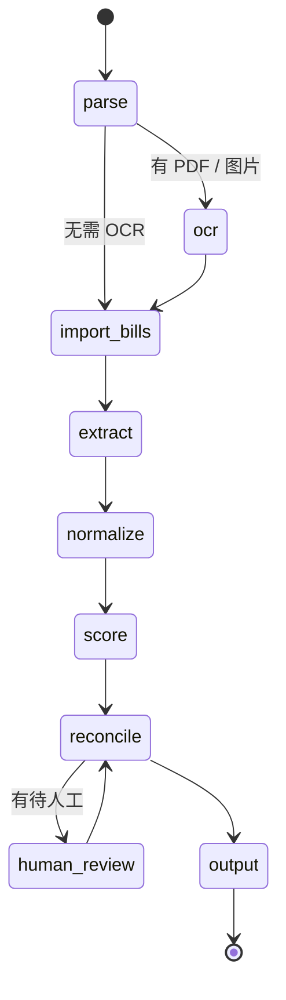

# Shipping Bill Agent：航运智能账单助手

这个 Agent 从邮件、PDF 账单、扫描件、Excel、Word 中读取航运 / 货代费用，转成结构化的费用记录，再和已有账单匹配，判定新增、更新、无变化或待人工复核，并从记账主体的视角判断 AR/AP。基于 Python + LangChain / LangGraph，LLM 使用 DeepSeek。

**设计原则**：LLM 只负责理解非结构化文本，也就是结构化抽取。标准化、校验、匹配、AR/AP、操作判定、置信度都用确定性代码实现，结果可以测试、复现和解释。LLM 抽取的每个字段都要附原文证据，由代码核验，从机制上防止编造。

详细设计见 [development.md](development.md)。

## 处理流程



| 节点 | 做什么 | LLM |
|---|---|---|
| parse | EML / Excel / Word / 账单 JSON 解析，邮件附件递归；PDF、图片登记为待 OCR | 否 |
| ocr | PDF 文字层优先，扫描页和图片用 PaddleOCR PP-StructureV3；按文件哈希缓存 | 否 |
| import_bills | 输入中的已有账单 JSON 先入库（幂等） | 否 |
| extract | 结构化抽取 skill：抽取 + 证据代码核验 + LLM 审核，外面包一层数据校验 hook（V1–V8），失败带原因重试 | **是** |
| normalize | 费用名、币种、付款方式、单据类型、日期标准化，原始值和标准值都保留 | 否 |
| score | 置信度 = OCR 置信度 × 证据覆盖率 × 惩罚系数，低于 0.8 转人工 | 否 |
| reconcile | AR/AP + 4 级匹配 + CREATE / UPDATE / NO_CHANGE / PENDING_REVIEW + 字段级 diff，一个批次一个事务 | 否 |
| human_review | `interrupt` 暂停，人工 approve / edit / reject 后继续，不重新抽取 | 否 |
| output | Pydantic 校验后输出标准 JSON；每次运行写审计目录 | 否 |

## 验收标准对照

| 验收标准 | 实现 | 位置 |
|---|---|---|
| 1. 解析 EML 正文及附件 | EML 解析 + Router 递归 | `parsers/eml.py`、`parsers/router.py` |
| 2. 调用 OCR 识别 PDF 和图片 | PDF 文字层 + PaddleOCR，结果按哈希缓存 | `ocr/` |
| 3. 解析 Excel 和 Word 中的费用表格 | 表格转结构化文本，合并单元格展开 | `parsers/excel.py`、`parsers/word.py` |
| 4. 提取单据编号、费用、金额、币种 | LLM 抽取 + 证据核验 + 审核 + 校验 hook | `extract/`、`skills/` |
| 5. 区分新增账单与更新账单 | 4 级匹配 + 操作判定 + 字段级 diff | `billing/matcher.py`、`billing/operation.py` |
| 6. 结合记账主体判断 AR/AP | 主体由参数给定，按收付款方判定，不交给模型推断 | `rules/ar_ap.py` |
| 7. 检测重复账单与数据冲突 | 校验规则 V1–V8；同批重复、匹配冲突转人工 | `validate/`、`billing/` |
| 8. 通过 Harness 工程提升稳定性 | 状态机编排、重试、置信度、HITL、trace、golden 回归 | `graph/`、`harness/`、`skills/` |
| 9. 补充思考（5 点以上） | 12 点 | [development.md 第 12 章](development.md) |
| 10. 基于 Python 和 LangChain | LangChain skill / middleware + LangGraph | 全局 |

## 安装

需要 Python 3.11 或更高版本。

```bash
pip install -e ".[dev]"
```

要识别扫描件或图片，再装本地 OCR（GPU 版改装 `paddlepaddle-gpu`）：

```bash
pip install -e ".[ocr]"
```

LLM 使用 DeepSeek，需要设置环境变量 `DEEPSEEK_API_KEY`。模型默认 `deepseek-v4-pro`，可以用 `--model` 或环境变量 `BILL_AGENT_MODEL` 切换。

## 快速开始

端到端处理一批文件（文件或目录都可以；输入里如果有已有账单 JSON，会先入库）：

```bash
python -m bill_agent run <样例目录> --entity PAT --out output/result.json
```

有待人工复核的记录时，程序会暂停，并在 `output/runs/<run_id>/` 下写出 `tickets.json` 和待填写的 `decisions.json`。逐条填好 `action` 后继续：

```bash
python -m bill_agent resume <run_id>
```

`decisions.json` 每项的格式：

```json
{"ticket_id": "...", "action": "edit", "changes": {"currency": "USD"}, "note": "原件币种为美元"}
```

| action | 处理 |
|---|---|
| approve | 清空待人工原因，按原记录再匹配、判定一次 |
| edit | 先按 `changes` 改字段（改了交易方时重判 AR/AP），再同 approve |
| reject | 不写库，保持 PENDING_REVIEW |

不需要暂停时加 `--no-hitl`，待人工的记录直接以 PENDING_REVIEW 输出。

## 输出

每个费用行输出一条记录。核心字段严格按题目样例；加 `--strict-schema`（`apply`）后只输出核心字段。

```json
{
  "operation": "CREATE",
  "document_info": {"document_type": "Debit Note", "reference_no": "DC-108478", "document_date": "2026-10-24",
                    "bl_nos": ["MAEU275752922", "CGT260801188"], "booking_no": null,
                    "container_nos": ["MRSU2571577", "TCLU8619685"]},
  "transaction_party": {"issuer": "NEPTUNE SHIPPING LIMITED", "recipient": null,
                        "payee": "NEPTUNE SHIPPING LIMITED", "payer": null},
  "charge_details": {"charge_item": "Handling Charge", "amount": 65.0, "currency": "USD", "payment_term": "CC",
                     "original_charge_item": "HANDLING CHARGE", "line_no": 1, "quantity": 1.0, "unit_price": 65.0},
  "financial_attributes": {"accounting_entity": "PAT", "posting_type": null},
  "audit_trail": {"ai_reasoning": ["级别 1（单据号 + 费用名称）：未命中", "...", "AR/AP：PAT 不是交易任何一方，posting_type 为 null"],
                  "source_files": ["PDF 示例账单2.pdf"], "source_text": ["HANDLING CHARGE ... 65.00"],
                  "matched_rule": null, "matched_record_id": null, "changed_fields": [],
                  "confidence": 1.0, "review_reasons": []}
}
```

审计目录 `output/runs/<run_id>/` 中包括：

- `run.json`：运行参数；
- `extraction.json`：每一轮抽取、审核和校验的记录；
- `trace.jsonl`：每个节点的耗时、摘要和 token 用量；
- `tickets.json` / `decisions.json`：人工复核的待办和处理结果。

## 命令一览

所有命令都通过 `python -m bill_agent <子命令>` 运行，加 `-h` 查看完整参数。

| 子命令 | 作用 | LLM |
|---|---|---|
| `run` | 端到端：解析 → OCR → 抽取 → 标准化 → 置信度 → 入账；遇到待人工时暂停 | 是 |
| `resume` | 读入人工复核结果，从 reconcile 继续 | 否 |
| `parse` | 解析成 RawDocument；加 `--ocr` 时做本地 OCR | 否 |
| `extract` | 只做结构化抽取（含核验、审核和校验 hook） | 是 |
| `validate` | 对已保存的抽取结果做数据校验 | 否 |
| `normalize` | 抽取结果 → 标准化的费用行记录 | 否 |
| `apply` | 抽取结果 → 标准化 → AR/AP → 匹配 → 判定，写库并输出 JSON | 否 |
| `db-import` | 已有账单 JSON 导入 SQLite 账单库（重复导入结果不变） | 否 |
| `golden-eval` | Golden 回归：场景输入 → 期望输出逐字段对比 | 否（`--extracted` 时用已保存的抽取结果） |
| `extract-eval` | 抽取题目样例，与 golden 标注逐字段对比 | 是 |
| `review-eval` | 评测审核模型：golden 不应误报，改坏的字段应被发现 | 是 |
| `ask` / `qa-eval` | 基于解析 / OCR 结果向 LLM 提问，检验解析层能否支撑回答 | 是 |

分步运行（方便单独调试某一层）：

```bash
python -m bill_agent extract <文件或目录> --out output/extracted.json
python -m bill_agent apply output/extracted.json --db data/bills.db --out output/result.json
```

## 评测与回归

| 评测 | 检验什么 | 当前结果 |
|---|---|---|
| `pytest` | 单元测试 + golden 场景（离线，不调用 LLM） | 305 通过 |
| `golden-eval` | 6 个场景、27 条输出记录、24 个字段（操作、核心字段、匹配规则、变更字段、是否待人工） | 648 / 648 |
| `golden-eval --extracted` | 真实 LLM 抽取结果走完后半段，与期望输出对比（端到端） | 144 / 144 |
| `extract-eval` | LLM 抽取与人工标注逐字段对比 | 90 / 90 |

Golden 场景在 [tests/fixtures/golden/scenarios/](tests/fixtures/golden/scenarios/)，每个场景用一个全新的内存账单库：

| 场景 | 覆盖 |
|---|---|
| 01_first_import | 空库导入 3 份样例：全部 CREATE，PAT 不是交易方时 posting_type 为 null |
| 02_reimport_no_change | 同一批单据重复到达：全部 NO_CHANGE，不重复入账 |
| 03_duplicate_in_batch | 同一批次里同一张 DN 出现两次：第二份判为冲突，转人工 |
| 04_revised_debit_note | 修订版 DN 改了一行金额：该行 UPDATE 并列出变更字段，其余 NO_CHANGE |
| 05_notice_matched_by_bl | 没有单据号的到货通知：按提单号 + 费用名 + 币种匹配后 UPDATE |
| 06_ar_ap | PAT 是付款方时为 AP，是收款方时为 AR |

场景输入引用 [tests/fixtures/samples/](tests/fixtures/samples/) 里人工标注的抽取结果，用 `"set"` 改写个别字段，构造题目样例里没有的情况。代码改动导致期望变化时，按下面的顺序更新：

1. 运行 `python -m bill_agent golden-eval --update`，把实际输出写成期望；
2. 在 `git diff` 里逐条核对，确认变化是预期的；
3. 再提交。

题目样例原件含银行账户信息，不放进仓库；需要跑 `extract-eval` 时，用 `--samples-dir` 指向原件所在目录：

```bash
python -m bill_agent extract-eval --samples-dir <题目测试集目录>
python -m bill_agent golden-eval --extracted output/extracted.json
```

## 标准化规则（`src/bill_agent/normalize/`）

标准化是纯代码，不调用 LLM。原始值和标准值都保存（`*_raw` 字段）；原文写法不同但标准值相同时，不算变更。处理不了的写进 `review_reasons`，转人工。

| 字段 | 规则 |
|---|---|
| 费用名称 | 只改写 [config/charge_mapping.yaml](config/charge_mapping.yaml) 中列出的名称（忽略大小写、空格、标点后精确匹配）；表外名称原样照抄，不做同义替换 |
| 币种 | 行级优先，其次单据级；先查 [config/currency_alias.yaml](config/currency_alias.yaml)，再用 ISO 4217 校验。单独的 `$` 默认为美元，港币 / 新加坡元须写 `HK$` / `S$` |
| 付款方式 | `P`/`PP`/`Prepaid`/`预付`/`寄付` → PP；`C`/`CC`/`Collect`/`到付` → CC；无法识别时为 null |
| 单据类型 | 按关键词归为 Credit Note / Invoice / Debit Note / Other |
| 日期 | 英文月份直接解析；数字日期看 4 位年份的位置：年在前为年/月/日，年在后为月/日/年（第一段大于 12 时只能是日/月）；年份不是 4 位时转人工 |

## 架构分层

代码按 agent harness 的层次组织。节点不直接依赖 LangGraph / LangChain 类型，以后换成自研 harness 时只需替换适配层。

| 层 | 当前实现 | 位置 |
|---|---|---|
| Model | DeepSeek，经 `langchain-deepseek`，temperature 0 | `llm.py` |
| Tool / Skill | 结构化抽取 skill（抽取 + 证据核验 + 审核） | `skills/extraction.py`、`extract/` |
| Hook | 数据校验 hook（LangChain AgentMiddleware），失败带原因重试，最多 3 次 | `skills/validation_hook.py`、`validate/` |
| Runtime | LangGraph 状态机；节点接口 `node(state, deps) -> (update, summary)` | `graph/` |
| State / Memory | 可序列化 Pydantic 状态 + SQLite checkpointer；SQLite 账单库 | `graph/state.py`、`billing/repository.py` |
| HITL | `interrupt` 暂停、ticket / decision 跨进程恢复 | `graph/nodes.py` |
| Trace / Eval | `trace.jsonl`、置信度、golden 回归、抽取 / 审核评测 | `harness/`、`extract/review_eval.py` |

## 目录结构

```
config/                 标准化表（费用名、币种别名、记账主体别名、公司名别名）
src/bill_agent/
  parsers/              多格式解析与 Router
  ocr/                  PDF 文字层 + PaddleOCR + 缓存
  extract/              LLM 抽取、证据核验、LLM 审核、抽取评测
  skills/               结构化抽取 skill 与数据校验 hook
  validate/             抽取结果校验规则（V1–V8）
  normalize/            标准化
  rules/                AR/AP 判定
  billing/              SQLite 账单库、账单 JSON 导入、4 级匹配、操作判定
  graph/                LangGraph 编排（状态、节点、组装）
  harness/              置信度、golden 回归
  models/               Pydantic 数据模型（RawDocument → ExtractedDocument → ChargeRecord → OutputRecord）
tests/
  unit/                 单元测试与 golden 场景测试
  fixtures/samples/     人工标注的 golden 抽取结果（原件不入库）
  fixtures/golden/      golden 端到端场景
development.md          开发文档（设计、取舍、待确认问题、补充思考）
```

## 测试

```bash
pytest
```

## 打包交付

交付物是这个 Git 仓库。需要 zip 时，从已提交的版本打包（只包含受版本控制的文件，不含 `.venv`、`data/`、`output/` 和样例原件）：

```bash
git archive --format=zip --prefix=shipping-bill-agent/ -o shipping-bill-agent.zip HEAD
```
