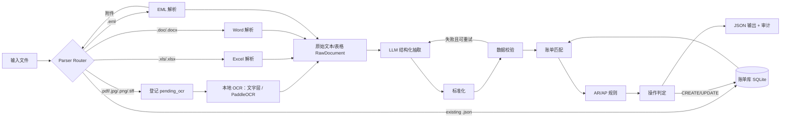
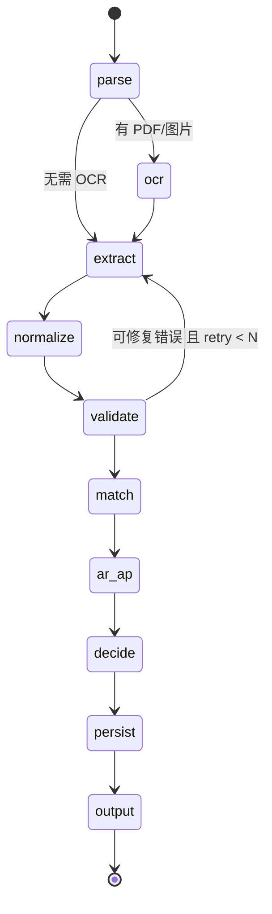

# 航运智能账单助手 Agent：开发文档

> 版本：v0.2（草案）｜ 日期：2026-11-01 ｜ 依据：test.pdf（AI agent 笔试题，最新版）

---

## 1. 项目概述

航运和货代业务的费用信息散落在邮件、PDF 账单、扫描件、Excel 和 Word 中。本项目要开发一个 Agent，能自动完成以下工作：

1. 解析多种格式的输入（EML / PDF / 图片 / Excel / Word / 已有账单 JSON）；
2. PDF 和图片登记为待 OCR，由本地 OCR 补充文本和表格（PDF 文字层优先，扫描页和图片用 PaddleOCR）；
3. 抽取单据和费用明细，并对费用名称、币种、付款方式做标准化；
4. 与已有账单做匹配，判定新增、更新、无变化或待人工复核；
5. 从记账主体的视角判断 AR/AP；
6. 校验数据，识别重复、冲突和低置信度结果；
7. 按约定格式输出 JSON，并保留来源和处理依据。

**强制约束**：开发语言为 Python，框架为 LangChain。交付物为代码 zip 或 Git 仓库。

---

## 2. 需求与模块对照

| 验收标准 | 负责模块 | 章节 |
|---|---|---|
| 1. 解析 EML 正文及附件 | `parsers/eml.py` + Router 递归 | 6.1 |
| 2. 调用 OCR 识别 PDF 和图片 | `parsers/pdf_image.py`（登记）+ `ocr/`（文字层 + PaddleOCR） | 6.1、6.2 |
| 3. 解析 Excel 和 Word 中的费用表格 | `parsers/excel.py`、`parsers/word.py` | 6.1 |
| 4. 提取单据编号、费用、金额、币种 | `extract/` (LLM 结构化抽取) | 6.3 |
| 5. 区分新增账单与更新账单 | `billing/matcher.py`、`billing/operation.py` | 6.6、6.7 |
| 6. 结合记账主体判断 AR/AP | `rules/ar_ap.py` | 6.8 |
| 7. 检测重复账单与数据冲突 | `validate/`、`billing/matcher.py` | 6.5、6.6 |
| 8. 通过 Harness 工程提升稳定性 | `graph/`、`harness/` | 7、8 |
| 9. 补充思考（5 点以上） | 本文第 12 章 | 12 |
| 10. 基于 Python 和 LangChain 实现 | 全局 | 3 |

---

## 3. 技术栈

| 类别 | 选型 | 说明 |
|---|---|---|
| 语言 | Python 3.11+ | |
| Agent 框架 | LangChain + LangGraph | 用 LangGraph 状态机编排主流程，LLM 调用走 LangChain |
| LLM | DeepSeek（`langchain-deepseek`，默认 `deepseek-v4-pro`） | 关闭思考模式，用 function calling 做结构化输出 |
| 结构化输出 | Pydantic v2 + `with_structured_output` | 强约束 LLM 输出 |
| 邮件解析 | `email` 标准库（`policy.default`） | 处理头部解码和多级 MIME |
| Excel | `openpyxl`、`pandas`、`xlrd`（.xls） | |
| Word | `python-docx`；.doc 先用 LibreOffice 转换 | |
| PDF 文字层 | `pdfplumber` | 系统生成的 PDF 直接读文字层，不走 OCR |
| OCR | PaddleOCR 3.x（PP-StructureV3：版面 + PP-OCRv5 + 表格结构） | 本地运行；可选依赖 `.[ocr]` |
| 本地数据库 | SQLite（`sqlite3` 或 SQLModel） | 轻量，支持索引和事务 |
| 模糊匹配 | `rapidfuzz` | 用于公司名（记账主体别名）匹配 |
| 测试 | `pytest` | |
| 配置 | `pydantic-settings` + `.env` / YAML | |

---

## 4. 总体架构



**设计原则：LLM 只负责理解非结构化文本（结构化抽取）。** 匹配、AR/AP、操作判定、校验全部用确定性代码实现。这样结果可测试、可复现、可解释。

---

## 5. 目录结构

```
shipping-bill-agent/
├── README.md
├── development.md
├── pyproject.toml
├── .env.example
├── config/
│   ├── settings.yaml          # 记账主体、阈值、OCR、LLM 配置
│   ├── charge_mapping.yaml    # 费用名称标准化表
│   ├── currency_alias.yaml    # 币种别名 → ISO 4217
│   └── entity_alias.yaml      # 记账主体/公司别名
├── src/bill_agent/
│   ├── main.py                # CLI 入口
│   ├── models/                # Pydantic 数据模型
│   │   ├── raw.py             # RawDocument
│   │   ├── extraction.py      # ExtractedDocument / ExtractedCharge
│   │   ├── bill.py            # BillRecord（数据库记录）
│   │   └── output.py          # 标准输出格式
│   ├── parsers/
│   │   ├── detect.py          # 文件头识别类型
│   │   ├── router.py
│   │   ├── eml.py
│   │   ├── html_text.py       # HTML 正文 → 文本 + 表格
│   │   ├── excel.py
│   │   ├── word.py
│   │   ├── convert.py         # LibreOffice 转换 .doc/.xls
│   │   ├── table_utils.py     # 表头定位
│   │   ├── blob_store.py      # 原文件存档
│   │   ├── json_bill.py
│   │   └── pdf_image.py       # 登记为 pending_ocr
│   ├── ocr/
│   │   ├── interface.py       # OCRBackend 接口、run_ocr
│   │   ├── pdf_text.py        # PDF 文字层读取 / 页面渲染
│   │   ├── paddle.py          # PaddleOCR PP-StructureV3 封装
│   │   └── local.py           # LocalOCR：按页组合文字层与 OCR
│   ├── extract/
│   │   ├── prompts.py
│   │   └── extractor.py
│   ├── normalize/
│   │   ├── charge.py
│   │   ├── currency.py
│   │   └── payment_term.py
│   ├── validate/
│   │   ├── rules.py
│   │   └── evidence.py        # 原文溯源校验
│   ├── billing/
│   │   ├── repository.py      # SQLite 读写
│   │   ├── matcher.py         # 4 级匹配
│   │   └── operation.py       # CREATE/UPDATE/NO_CHANGE/PENDING_REVIEW + diff
│   ├── rules/
│   │   └── ar_ap.py
│   ├── graph/
│   │   ├── state.py
│   │   ├── nodes.py
│   │   └── build.py           # LangGraph 组装
│   └── harness/
│       ├── retry.py
│       ├── confidence.py
│       └── tracing.py
├── data/
│   ├── samples/               # 题目样例（百度网盘下载）
│   └── bills.db
└── tests/
    ├── unit/
    ├── golden/                # 输入 + 期望输出
    └── test_end_to_end.py
```

---

## 6. 模块设计

### 6.1 多格式解析（Parser Router）

**状态：已实现**，代码在 `src/bill_agent/parsers/`。这一层只规定各类文件怎么进来、进来之后怎么处理，统一产出 `RawDocument`（定义在 `models/raw.py`），不提取任何业务字段。

**各类输入的去向：**

| 输入 | 处理 | 产出状态 |
|---|---|---|
| EML | 解析邮件头和正文（text/plain 优先，表格从 text/html 中提取）；每个附件送回 Router 递归处理；转发邮件（message/rfc822）同样递归 | `parsed` |
| Excel（.xlsx / .xls） | 读取每个可见工作表，展开合并单元格，定位表头；表头以上的内容保留在 text 中 | `parsed` |
| Word（.docx / .doc） | 按文档顺序提取段落和表格；页眉、页脚、文本框的内容也收进来 | `parsed` |
| PDF / 图片 | **只登记，不识别**：原文件按内容哈希存档（`file_ref`），text 留空 | `pending_ocr` |
| 已有账单 JSON | 原样交给账单库模块，不生成 RawDocument | — |
| 其他（txt、zip 等） | 记入 `skipped` 并写明原因 | — |

**RawDocument 的状态：**

```
EML / Excel / Word ──解析──▶ parsed ─────────────────┐
PDF / 图片 ──登记──▶ pending_ocr ──OCR 成功──▶ ocr_done ──┼──▶ 进入 LLM 抽取
                              └─OCR 失败──▶ ocr_failed ─┘（不进入抽取，可重试）
```

状态和字段必须一致，否则模型直接报错：

- PDF 和图片不能是 `parsed`；其他类型只能是 `parsed`。
- `pending_ocr` 时必须有 `file_ref`，text 和 tables 必须为空。
- `ocr_done` 时必须记录 `ocr_engine`，text 和 tables 不能同时为空。
- `ocr_failed` 时必须记录 `ocr_error`；原文件引用保留，方便重试。
- 只有 `parsed` 和 `ocr_done` 的文档会进入抽取（`ready_for_extraction`）。

**模块职责：**

| 模块 | 职责 |
|---|---|
| `detect.py` | 以文件头（magic bytes）为主识别类型，扩展名和 MIME 只做兜底，所以附件扩展名错了也能识别（例如实际是 PDF 的 `DN.dat`）；同时给出正确的扩展名和 MIME |
| `router.py` | 分发到对应解析器；内容相同（sha256 相同）的文件只处理一次；单个文件失败只记入 `skipped`，不中断整批；嵌套层数上限 5；补齐文件名、MIME、大小；`source_path` 使用**相对于输入目录的路径**，统一用 `/` 分隔（传入单个文件时只用文件名），附件追加 `#attachments/<文件名>` |
| `eml.py` | charset 异常时逐级降级；正文中内嵌的小图片（<20KB，通常是 logo）不登记 |
| `excel.py` / `word.py` | .xls / .doc 优先用 xlrd 读取，否则用 LibreOffice 转换；合并单元格展开为重复值，保证每列和表头对齐 |
| `table_utils.py` | 定位表头：在前 30 行里，取命中关键词的**不同值**最多、且**不含数字单元格**的那一行 |
| `blob_store.py` | 按内容寻址保存原文件（`<sha256>.<真实扩展名>`） |
| `json_bill.py` | 已有账单 JSON 支持 `[...]`、`{"bills"/"records"/"data": [...]}` 和单个对象三种结构 |

邮件正文本身也可能就是一份对账单或改账说明（例如“请将 Handling Fee 改为 USD 40”），所以**正文也作为一份 RawDocument 进入抽取流程**。

**用来检查解析效果的命令：**

```bash
python -m bill_agent parse <文件或目录>... [--blob-dir data/blobs] [--out parsed.json]
```

### 6.2 OCR 服务

**状态：已实现本地 OCR**（`src/bill_agent/ocr/`）。题目指定的 OCR API 不接入。

```python
from bill_agent.ocr import LocalOCR, run_ocr
docs = run_ocr(parse_result.documents, LocalOCR(device="cpu"))   # device="gpu" 需安装 paddlepaddle-gpu
```

```bash
pip install -e ".[ocr]"
python -m bill_agent parse <文件或目录>... --ocr [--ocr-device cpu|gpu] [--out output/ocr.json]
```

**按页选择识别方式：**

| 输入 | 处理 | `ocr_engine` | 置信度 |
|---|---|---|---|
| PDF 页有可用文字层 | `pdfplumber` 读取 layout 文本（保留列对齐） | `pdf-text-layer` | 1.0 |
| PDF 页没有文字层（扫描件），或文字层字体缺少 Unicode 映射（`(cid:N)`、替换字符超过 5%） | 按 200 DPI 渲染成图片，交给 PaddleOCR | `paddleocr/PP-StructureV3` | 文本行分数平均值 |
| 图片（多页 TIFF 每帧一页） | PaddleOCR | `paddleocr/PP-StructureV3` | 同上 |

一份文档里两种方式都用到时，`ocr_engine` 记为 `pdf-text-layer+paddleocr/PP-StructureV3`，`raw_response.pages[]` 里逐页记录来源。文档置信度取各页的最小值。

**设计取舍：**

- **文字层优先**：题目测试集的 2 个 PDF 和邮件里的 MBL / HBL 都是系统生成的，带文字层。直接读取与原文完全一致，不会出现 0/O 之类的识别错误，耗时也只有毫秒级。
- **文字层不提取表格**：在 DN DC-108478 上，`pdfplumber` 的表格提取把三行费用挤进一个单元格，还丢了 DESCRIPTION 列。错误的表格比没有表格更危险，所以费用表交给 LLM 从 layout 文本中读取。
- **OCR 表格**：PP-StructureV3 输出 HTML 表格，转换为二维数组时展开 colspan / rowspan，合并单元格重复填值，表头交给 `build_table` 统一定位，与 Excel / Word 一致。
- **不丢文本行**：PP-StructureV3 的版面分析会漏掉部分文本行（ZIM 样例的 `1X40 HC` / `JXLU4504463` 不在任何版面块里）。识别到但没有进入版面块的行，补在文本末尾的 `[未归入版面块的识别文本]` 下。
- **结果缓存**：`CachedOCR` 按文件 SHA256 + 后端名缓存到 `data/ocr_cache/`，同一文件不重复识别（`--ocr-cache ''` 关闭）。
- **低置信度留痕**：分数低于 0.8 的文本行写入 `warnings`；每一行的文字、分数和坐标保存在 `raw_response`，供校验环节核对具体字段。
- **模型懒加载**：只有遇到扫描页或图片才加载 Paddle。首次运行时会下载模型到 `~/.paddlex`。
- **已知问题**：Paddle 3.3 的 CPU 版开启 oneDNN 时，版面模型会报 `ConvertPirAttribute2RuntimeAttribute` 错误，因此固定 `enable_mkldnn=False`。CPU 上每张图片约 1 分钟，可以改用 GPU 加速。

**样例上的识别结果：**

- ZIM 发票 PNG：费用表完整识别（两行费用 + 合计 26.90），平均置信度 0.96。Base 列第二行原图左侧被裁切，只显示 `ᴾTT`，OCR 结果为 `TT`。
- 邮件正文的 `InsertPic_C25B.jpg` 是邮件签名里的宣传横幅（"中美跨境·数智工具"），不含费用信息。

**接口**（`ocr/interface.py`）：其他 OCR 实现（视觉模型、题目原 API）也可以按同一接口接入。

```python
class OCRBackend(Protocol):
    name: str                                                    # 默认记入 RawDocument.ocr_engine
    def recognize(self, doc: RawDocument, data: bytes) -> OCRResult: ...

@dataclass
class OCRResult:
    text: str
    tables: list[list[list[str | None]] | RawTable] = []         # 二维表格即可，表头由统一逻辑定位
    confidence: float | None = None                              # 0~1
    raw_response: dict | None = None                             # 原始输出，用于审计
    warnings: list[str] = []
    engine: str | None = None                                    # 实际使用的引擎，覆盖 backend.name
```

`run_ocr` 只处理 `pending_ocr` 和 `ocr_failed` 状态的文档，从 `file_ref` 读取原文件。识别成功调用 `complete_ocr()` 转为 `ocr_done`，抛出异常则调用 `fail_ocr()` 转为 `ocr_failed`。其他文档原样返回，顺序不变。

### 6.3 信息抽取（LLM）

用 `llm.with_structured_output(ExtractedDocument)` 做抽取，temperature 设为 0。

**抽取结构只包含 test.pdf 要求的字段**（代码见 `src/bill_agent/models/extraction.py`）。单据上的其他信息，如船名、港口、结算条款、汇率、费用代码等，一律不抽取，后续业务需要时再加。`tests/unit/test_samples.py::test_schema_only_has_spec_fields` 锁定了字段集合：新增字段必须有题目依据，并同步修改这个测试。

```python
class ExtractedCharge:                 # 每个费用项一条（四.4）
    line_no: int                       # 行序号，同名费用靠它区分（四.4、四.7 重复提取）
    charge_name_raw: str               # 费用名称（四.2）
    quantity / unit_price / amount     # 数量、单价和金额（四.2）；贷记、退款为负数
    currency_raw: str | None           # 币种（四.2）
    payment_term_raw: str | None       # PP / CC 等付款方式（四.2）
    evidence: dict[str, Evidence]

class DocumentTotal:                   # 小计、税额和总计（四.2），按币种分组
    currency_raw, subtotal, tax_amount, total_amount

class ExtractedDocument:
    source_id: str                     # 文件来源（二.9）
    document_type_raw, reference_no, document_date_raw   # 单据类型、编号及日期（四.2）
    issuer, recipient                  # 签发方和接收方（四.2）
    payee, payer                       # 单据写明的收款方 / 付款方：收费方向（四.6）
    bl_nos: list[str]                  # 提单号（四.5 规则 2）
    booking_no: str | None             # 订舱号（四.5 规则 3）
    container_nos: list[str]           # 箱号（四.5 规则 4）
    currency_raw: str | None           # 单据级币种；费用行没有币种时使用（四.2）
    charges: list[ExtractedCharge]
    totals: list[DocumentTotal]
    change_instructions: list[ChangeInstruction]   # 明确的改账要求（四.5 只改明确要求变更的字段）
    evidence: dict[str, Evidence]      # 字段名 → 原文证据（二.9、七.1 不得虚构）
```

- 需要标准化的字段（单据类型、日期、币种、付款方式、费用名）在这一层只保存原文（`*_raw`），由 normalize 模块转换。
- 金额内部用 `Decimal`；像 `4O.00` 这种字母混进数字的值直接报错，交给校验环节（四.7）。
- `evidence` 只能指向已定义的字段，模型编造的字段名会被拒绝。

**样例上的处理说明**（人工标注的理想抽取结果在 `tests/fixtures/samples/*.expected_extraction.json`）：

| 样例现象 | 处理 |
|---|---|
| DN DC-108478 中有两行 `HANDLING CHARGE`（65.00 / 35.00） | 用 `line_no` 区分。匹配规则 1（单据号 + 费用名）不唯一，需要再用行号或金额区分 |
| DN 收件方为空，但写明 “BALANCE DUE TO NEPTUNE…”；ZIM 写明 “payments must be issued to…”；CMA 写明 “REMIT TO CMA CGM” | 填入 `payee`，作为 AR/AP 的主要方向证据（见 6.8） |
| DN 同时有 Master B/L 和 House B/L | 两个都放进 `bl_nos`，匹配时都参与 |
| DN 费用行没有币种，只有表头 CURRENCY USD | 填单据级 `currency_raw`，费用行缺币种时继承 |
| ZIM 发票日期 10/03/2025 | 日期只存原文，标准化时再判断 MM/DD 或 DD/MM |
| ZIM 没有 PP/CC | `payment_term_raw` 保持 null，不做推测 |
| 样例中有银行账号、路由号 | schema 中没有对应字段，不抽取 |
| CMA CGM General Notice（PDF示例账单1）**没有单据编号** | `reference_no` 为 null；匹配规则 1 不可用，靠提单号走规则 2 |
| B/L 在同一页写作 `CMDUCHN4053601` 和 `CMDU CHN4053601` | 匹配前去掉提单号中的空格 |
| Pre-alert 邮件**正文里有一笔费用**：`SHA pay TAR：H/C $50`，同时写明 `Carrier Free H/C` | 邮件正文也要抽取费用。`H/C` 不在题目给的标准化表中，原样保留；`SHA` / `TAR` 原样抽取为付款方和收款方 |
| 同一封邮件写明 `FREIGHT PREPAID` | 只适用于运费，不能套用到 H/C 这笔费用上 |
| 邮件正文嵌入的 `InsertPic_C25B.jpg` | OCR 后确认是邮件签名里的宣传横幅，不含费用 |

Prompt 要点：
- 只从**本单实际收费的费用行**抽取。条款或说明里的金额（如“取消 I.T. 收 $25”“司机等待 $150/小时”“误还箱 $1100”）是费率说明，不是费用；
- 多页单据会重复页眉和地址块，同一费用只抽取一次；
- 提单（MBL/HBL）不生成费用行，只抽取提单号、箱号等匹配信息；Pre-alert 等通知邮件只抽取**明确写出金额的费用**（如 `SHA pay TAR：H/C $50`），`Carrier Free H/C` 这类免收说明不生成费用；
- 原文中没有的字段一律填 null，不要推测；
- 金额只输出数字，去掉千分位和货币符号；
- 每个非 null 字段都必须附上原文片段作为证据；
- 原文表格按行逐条抽取，一行对应一个费用项。

### 6.4 标准化

| 对象 | 方法 | 失败处理 |
|---|---|---|
| 费用名称 | **只改写题目标准化表中列出的名称**：先把大小写、空格、标点统一，再与表中的原始名称和标准名称做精确匹配，命中则输出标准名称。例如 DN 的 `HANDLING CHARGE` 会输出为 `Handling Charge` | 表中没有的名称**原样照抄**（例如 `4 ADD'L DETENTION FREE TIME CHARGE`、`WHARFAGE`），不做模糊匹配，不交给 LLM 改写，也不因此标 PENDING_REVIEW |
| 币种 | 查别名表（`US$`/`USD$` → USD，`RMB`/`¥`/`CNY` → CNY），再用 ISO 4217 白名单校验 | 不合法则标 `PENDING_REVIEW` |
| 付款方式 | `PP`/`Prepaid`/`Freight Prepaid`/`预付` → PP；`CC`/`Collect`/`到付` → CC | 填 null |

标准化表（题目给定，放在 `config/charge_mapping.yaml`，后续可扩展）：

| 原始名称 | 标准名称 |
|---|---|
| Handling Fee, H/D Fee | Handling Charge |
| Doc Fee | Documentation Fee |
| THC | Terminal Handling Charge |
| Trucking Fee | Trucking Charge |
| Customs Fee | Customs Clearance Fee |
| Storage Fee | Storage Charge |

**原始名称和标准名称都要保存**，见 6.9 节的输出扩展字段。

### 6.5 数据校验

| 校验项 | 实现方式 | 失败后果 |
|---|---|---|
| 金额是否为有效数字 | 类型检查，并检查是否为 NaN 或无穷大 | 回到抽取环节重试，仍失败则标 PENDING_REVIEW |
| 币种是否符合 ISO 4217 | 白名单 | PENDING_REVIEW |
| 明细与合计是否一致 | 按币种分组，Σamount 与 subtotal 比较，subtotal + tax 与 total 比较，容差 0.01 | 降低置信度；差异超过阈值则标 PENDING_REVIEW |
| 数量 × 单价是否等于金额 | 容差 0.01 | 降低置信度 |
| OCR 混淆字符（0/O、1/l/I、5/S、8/B） | 对数字字段和单据号、箱号做模式检查。箱号遵循 ISO 6346（4 个字母 + 7 位数字，含校验位），可以直接计算校验位 | 先尝试自动纠正；有歧义则标 PENDING_REVIEW |
| 同一费用被重复提取 | 同一批次内按（单据号、标准费用名、金额、币种、箱号）去重，例如邮件正文和附件里重复出现的同一笔费用 | 合并，并在审计中记录 |
| 证据溯源 | `evidence.quote` 必须能在 RawDocument 原文中模糊匹配到 | 匹配不到的字段置为 null，并降低置信度 |
| 日期 | 能解析，且在合理范围内 | null |

题目要求“OCR 结果不能未经校验直接入账”。因此，**没有通过校验的记录只会输出为 PENDING_REVIEW，不会写入账单库。**

### 6.6 账单库与匹配

**记录粒度为费用行**，一张单据有 N 个费用就对应 N 条记录。

```sql
CREATE TABLE bill_records (
  record_id        TEXT PRIMARY KEY,   -- UUID
  reference_no     TEXT,
  document_type    TEXT,
  document_date    TEXT,
  issuer           TEXT,
  recipient        TEXT,
  bl_no            TEXT,
  booking_no       TEXT,
  container_no     TEXT,
  charge_item      TEXT,               -- 标准名
  charge_item_raw  TEXT,
  quantity         REAL,
  unit_price       REAL,
  amount           REAL,
  currency         TEXT,
  payment_term     TEXT,
  accounting_entity TEXT,
  posting_type     TEXT,
  version          INTEGER DEFAULT 1,
  updated_at       TEXT,
  source_ids       TEXT                -- JSON 数组
);
CREATE INDEX idx_ref_charge   ON bill_records(reference_no, charge_item);
CREATE INDEX idx_bl           ON bill_records(bl_no, charge_item, currency);
CREATE INDEX idx_booking      ON bill_records(booking_no, charge_item, currency);
CREATE INDEX idx_container    ON bill_records(container_no, document_date);

CREATE TABLE bill_history (           -- 每次 UPDATE 的旧值快照，用于回溯
  record_id TEXT, version INTEGER, snapshot TEXT, changed_at TEXT, source_id TEXT
);
```

启动时把已有账单 JSON 导入数据库（upsert）。

**匹配规则：4 级优先级，命中即停止，但会记录所有规则的命中情况。**

| 优先级 | 匹配键 |
|---|---|
| 1 | 单据号 + 费用名称 |
| 2 | 提单号 + 费用名称 + 币种 |
| 3 | 订舱号 + 费用名称 + 币种 |
| 4 | 箱号 + 交易双方 + 日期 + 金额 |

- 匹配键中有任何一个为 null，就跳过该级规则；
- 某一级命中**多条**记录，视为冲突，标 PENDING_REVIEW；
- 不同级别的规则命中了**不同的记录**，也视为冲突，标 PENDING_REVIEW；
- 交易双方比较前先经过公司别名表归一化。

### 6.7 操作判定与字段级 Diff

```
无匹配 且 校验通过                      → CREATE
有唯一匹配：
    待更新字段集合为空                    → NO_CHANGE   （含重复导入）
    待更新字段集合非空                    → UPDATE
冲突 / 校验失败 / 低置信度             → PENDING_REVIEW
```

**待更新字段的计算方式（落实“只修改输入材料明确要求变更的字段”）：**
1. 如果邮件正文或单据中有明确的改账指令（`change_instructions`），只更新指令涉及的字段；
2. 否则，视为单据本身就是修订后的版本（如 Revised DN）。只有同时满足以下三个条件的字段才会更新：输入中**非 null**、有**原文证据**、而且与原值**不同**；
3. null 字段和缺少证据的字段一律保留原值；
4. 每个被修改的字段都记录“旧值 → 新值 + 证据”，写入 `ai_reasoning`，旧值快照写入 `bill_history`。

### 6.8 AR/AP 判断

核心原则：**LLM 只抽取签发方、接收方、单据类型和金额，AR/AP 由规则函数计算。**

**第 1 步：确定记账主体。** **记账主体是 PAT**（已确认）。主体由外部配置（`settings.yaml` 或 CLI 的 `--entity`）提供，并配一张别名表（全称、简称、英文名），不让 LLM 去猜“我方是谁”。

PAT 的别名表（**已确认**）：`PAT`、`Pilot Aiship Tech co., Ltd.`、`湃乐多（上海）航运科技有限公司`。邮件中的 `SHA` **不是** PAT，不加入别名表。

**第 2 步：确定资金方向。**

**优先使用单据上明确写出的收款方**（payee，如 “REMIT TO”、“BALANCE DUE TO”、“payments must be issued to”）。三份样例里都有这一信息，而 CMA CGM 的 General Notice 不属于 DN/CN/Invoice，只能靠它判断方向。单据上没有写明收款方时，再按单据类型推断：

| 单据类型 | 收款方 | 付款方 |
|---|---|---|
| Debit Note / Invoice | 签发方 | 接收方 |
| Credit Note | 接收方 | 签发方 |

如果金额为负，或者文本中含有 refund / rebate / 退款等语义，方向取反。

**第 3 步：确定记账类型。**

| 情况 | posting_type |
|---|---|
| 钱流入 PAT（PAT 是收款方） | `AR` |
| 钱从 PAT 流出（PAT 是付款方） | `AP` |
| PAT 不是交易任何一方 | `null`（JSON 的 null，不是字符串）。**不因此标 PENDING_REVIEW**，其他字段照常输出 |
| 别名匹配分数介于阈值附近，无法确定是不是 PAT | `null` + `PENDING_REVIEW`，并在 `review_reasons` 中写明 |

**样例的期望结果：**

| 样例 | 收款方 ← 付款方 | 结果 |
|---|---|---|
| DN DC-108478 | Neptune ← Pilot Aiship Tech（PAT） | `AP` |
| ZIM Invoice ORFR1618731 | ZIM ← All America Forwarding | `null` |
| CMA CGM Notice（PDF示例账单1） | CMA CGM ← Neptune | `null` |
| Pre-alert 邮件（H/C $50） | TAR ← SHA | `null`（SHA 和 TAR 都不是 PAT） |

**第 4 步：用付款方式做交叉校验（辅助信号）。** PP 费用通常由起运港一方收取，CC 费用通常由目的港一方收取。如果主体的角色已知（Origin 或 Destination），而 PP/CC 推出的结论与第 3 步矛盾，就降低置信度并在审计中说明。这一步不推翻主判据。

**题目样例验证**：Destination Agent 向 Origin Agent 签发 Debit Note，记账主体为 Origin Agent。按第 2 步，付款方是接收方，也就是 Origin Agent，所以 posting_type 为 **AP**，与题目样例一致。

```python
def decide_posting_type(doc_type, issuer, recipient, entity, amount, refund_hint,
                        stated_payee=None, stated_payer=None):
    if stated_payee or stated_payer:                   # 单据明确写出的收付款方优先（如 "SHA pay TAR"）
        payee = stated_payee or (issuer if not same_entity(stated_payer, issuer) else recipient)
        payer = stated_payer or (recipient if same_entity(stated_payee, issuer) else issuer)
    else:
        payee, payer = (issuer, recipient) if doc_type in {"Debit Note", "Invoice"} \
                       else (recipient, issuer) if doc_type == "Credit Note" else (None, None)
    if payee is None:
        return None, "单据类型无法确定收费方向"
    if (amount is not None and amount < 0) or refund_hint:
        payee, payer = payer, payee
    if same_entity(entity, payee):  return "AR", f"{entity} 为收款方，钱流入 {entity}"
    if same_entity(entity, payer):  return "AP", f"{entity} 为付款方，钱从 {entity} 流出"
    return None, f"{entity} 不是交易任一方"          # 输出 null，不标 PENDING_REVIEW
```

### 6.9 输出格式

严格遵循题目第五节的核心结构，每个费用项输出一条记录：

```json
{
  "operation": "UPDATE",
  "document_info": {"document_type": "Debit Note", "reference_no": "DN-202609-001", "document_date": "2026-09-20"},
  "transaction_party": {"issuer": "Destination Agent", "recipient": "Origin Agent"},
  "charge_details": {"charge_item": "Handling Charge", "amount": 40.00, "currency": "USD", "payment_term": "PP"},
  "financial_attributes": {"accounting_entity": "Origin Agent", "posting_type": "AP"},
  "audit_trail": {"ai_reasoning": ["..."]}
}
```

**扩展字段**：在不改动核心字段的前提下，补充题目其他要求需要的字段。

- `charge_details.original_charge_item`：原始费用名，对应“同时保存原始和标准名称”；
- `charge_details.quantity`、`unit_price`；
- `document_info.bl_no`、`booking_no`、`container_no`；
- `audit_trail.source_file`、`source_text`（原文片段）、`matched_rule`、`matched_record_id`、`changed_fields`、`confidence`、`review_reasons`。

如果扩展字段可能影响对方的自动评测，可以加一个 `--strict-schema` 开关，开启后只输出核心字段。

输出前做最终检查：用 Pydantic 校验结构，并用 `json.dumps` 确认是合法 JSON；金额为数字类型；币种为三位代码；无法提取的字段填 `null`。

---

### 6.10 文件问答（检验解析 / OCR 结果能否支撑 LLM）

OCR 的最终用途是给 LLM 理解单据。在实现 M2 抽取之前，先用问答检验：只把解析 / OCR 后的文本交给模型，看它能否答对单据上的问题。实现在 `src/bill_agent/qa.py`，模型接入在 `src/bill_agent/llm.py`。

```bash
# 单次提问（-q 可重复）；不给 -q 进入交互模式
python -m bill_agent ask "D:/Leetcode/demo/笔试题AIAGENT/图片示例.png" -q "列出所有费用项目和金额"
# 按评测集逐题提问并判分
python -m bill_agent qa-eval tests/fixtures/qa --samples-dir "D:/Leetcode/demo/笔试题AIAGENT" --out output/qa_report.json
```

- **上下文**：每份文档的来源、识别方式、置信度、全文文本，以及低置信度行提示。未完成 OCR 的文档不进入上下文。
- **结构化输出**：`found`（文件中是否有答案）、`answer`、`evidence`（逐字摘录的原文）。
- **证据核验**：代码把每条 evidence 放回上下文中查找（忽略空白和大小写），找不到即视为编造。这与 M2 抽取的证据校验是同一套思路。
- **评测集**（`tests/fixtures/qa/*.qa.json`）：4 个样例共 35 题。`expect` 要求答案包含全部片段（比较时忽略大小写、空白和千分位逗号）；`expect_found: false` 是文件中没有答案的陷阱题，用来检验模型会不会编造。证据核验不通过的题也判为失败。

## 7. Agent 编排（LangGraph）

```python
class AgentState(TypedDict):
    inputs: list[str]
    raw_docs: list[RawDocument]
    extracted: list[ExtractedDocument]
    records: list[CandidateRecord]   # 标准化后的费用行
    errors: list[ValidationIssue]
    retry_count: int
    outputs: list[OutputRecord]
    trace: list[str]
```



| 节点 | 实现 | 是否调用 LLM |
|---|---|---|
| parse | Router | 否 |
| ocr | `run_ocr` + `LocalOCR`（只处理 pending_ocr / ocr_failed） | 否（PaddleOCR） |
| extract | 结构化抽取（把校验错误作为反馈带入下一次重试） | **是** |
| normalize | 查表（只改写标准化表中的名称） | 否 |
| validate | 规则校验 + 证据溯源 | 否 |
| match / ar_ap / decide | 确定性规则 | 否 |
| persist | 只写入 CREATE/UPDATE，单批次一个事务 | 否 |
| output | 序列化 + 最终 schema 校验 | 否 |

**为什么不用自由的 ReAct Agent**：财务数据要求结果可复现、可审计。流程固定的状态机能把 LLM 的不确定性限制在“理解文本”这一个环节里。同时，节点内部仍然可以以 LangChain Tool 的形式封装（如 `ocr_tool`、`lookup_bill_tool`），方便以后扩展成对话式 Agent，例如回答“这张单为什么被判为 AP”。

---

## 8. Harness 工程（提升稳定性与准确性）

1. **Schema 强约束**：所有 LLM 输出都用 Pydantic 定义，解析失败时自动带着错误信息重试。
2. **确定性优先**：temperature=0；匹配、AR/AP、操作判定、计算全部用代码完成。
3. **校验—反馈循环**：校验失败的具体原因（如“明细合计 120 ≠ 总计 150”）会作为反馈带入下一次抽取，最多重试 N 次（默认 2）。超过次数仍失败就标 PENDING_REVIEW，不会无限重试。
4. **证据锚定**：每个字段都必须有原文证据，并用代码核验，从机制上防止编造数据。
5. **置信度打分**：

   ```
   confidence = OCR置信度 × 证据覆盖率 × Π(校验惩罚系数)
   ```

   低于阈值（默认 0.8）的记录标 PENDING_REVIEW，并写明原因。
6. **幂等与缓存**：以文件哈希缓存 OCR 和 LLM 结果；同一文件重复处理时结果完全一致，且判定为 NO_CHANGE。
7. **事务与回滚**：每批次一个数据库事务，`bill_history` 保存版本快照。
8. **可观测性**：用 LangSmith 或本地 JSONL 记录每个节点的输入、输出、耗时和 token 用量。
9. **Golden 回归集**：用题目样例构造“输入 → 期望 JSON”，每次修改都跑 `pytest`，按字段统计准确率。

---

## 9. 配置示例

```yaml
# config/settings.yaml
accounting_entity:
  name: "PAT"
  aliases:                  # 已确认
    - "Pilot Aiship Tech co., Ltd."
    - "湃乐多（上海）航运科技有限公司"
  role: null                # origin / destination / null
parse:
  blob_dir: "data/blobs"    # PDF / 图片原文件存档
  max_depth: 5
ocr:
  engine: "local"           # PDF 文字层 + PaddleOCR PP-StructureV3
  device: "cpu"             # cpu / gpu
  dpi: 200                  # 扫描页渲染分辨率
  low_conf: 0.8             # 低于此分数的文本行写入 warnings
llm:
  provider: "openai"        # 待定
  model: "..."
  temperature: 0
thresholds:
  confidence_review: 0.8
  fuzzy_entity: 88
  amount_tolerance: 0.01
  max_extract_retries: 2
```

CLI：

```bash
python -m bill_agent run \
  --inputs data/samples/ \
  --existing data/samples/existing_bills.json \
  --entity "PAT" \
  --out output/result.json
```

---

## 10. 开发计划

| 阶段 | 内容 | 产出 |
|---|---|---|
| M0 | 下载样例数据；OCR 接口约定 | `ocr/interface.py` ✅ |
| M1 | 数据模型；EML / Excel / Word 解析器；Router 递归；PDF / 图片登记为待 OCR | 解析器 + 单元测试 ✅ |
| M1.5 | 本地 OCR：PDF 文字层 + PaddleOCR PP-StructureV3 | `ocr/local.py` + 单元测试 ✅ |
| M2 | LLM 结构化抽取 + 证据；标准化模块 | 抽取结果达到可用水平 |
| M3 | 校验模块；SQLite 账单库；JSON 导入 | |
| M4 | 4 级匹配；操作判定；字段级 diff；AR/AP 规则 | 核心业务闭环 |
| M5 | LangGraph 编排；重试与置信度；审计输出 | 端到端可运行 |
| M6 | Golden 测试集；README；整理补充思考；打包交付 | zip 或 Git 仓库 |

---

## 11. 待确认问题

1. **OCR**：✅ 已实现本地 OCR（PDF 文字层 + PaddleOCR）。GPU 加速（paddlepaddle-gpu）待定。
2. **记账主体**：✅ 已确认为 PAT（湃乐多 / Pilot Aiship Tech），由外部配置提供；`SHA` 不是 PAT。
3. **样例数据**：已有账单 JSON 的字段结构需要对照样例确认，并据此调整 `bill_records` 的映射。
4. **LLM 选型**：✅ DeepSeek（本机已配置 `DEEPSEEK_API_KEY`），模型名可用 `--model` 或 `BILL_AGENT_MODEL` 切换。
5. **扩展字段**：输出中加入扩展字段是否会影响评测，是否需要严格只输出样例中的字段。
6. **没有已有账单 JSON**：题目测试集（2 个 PDF、1 张图片、1 封 EML）里没有已有账单 JSON。账单库从空库开始，UPDATE 只能由同一批次中先后到达的单据触发。
7. **非账单文档**：测试集中的 MBL/HBL 提单本身没有费用，但带有提单号和箱号，可以作为上下文用于匹配。Pre-alert 邮件正文里有一笔 `SHA pay TAR：H/C $50`；✅ 已确认 SHA 不是 PAT，这笔费用照常抽取，posting_type 为 null。

---

## 12. 补充思考（对应验收第 9 条）

1. **记账主体必须显式指定**：同一张 Debit Note，对签发方是 AR，对接收方是 AP。不给定视角时，AR/AP 无法确定，所以主体应该作为系统输入，而不是交给模型推断。
2. **以费用行为粒度做幂等**：同一份账单可能通过邮件正文、PDF 附件、Excel 对账单多次出现。按费用行去重，再用 NO_CHANGE 处理重复导入，避免重复入账。
3. **证据驱动，防止编造**：每个字段都要求附带原文片段并用代码核验，把“不得虚构数据”从提示词里的要求变成系统强制执行的约束。
4. **修订单与变更意图**：业务上常见 Revised DN 和邮件改账（“请将 THC 改为 USD 120”）。系统需要区分“全量修订单”和“局部改账指令”，后者只能修改指令涉及的字段。
5. **多币种与汇率**：同一张单据可能同时有 USD 和 CNY 两种币种。合计校验必须按币种分组，不能跨币种加总；如果后续要折算本位币，还需要记录汇率来源和日期。
6. **Credit Note 与原单关联**：Credit Note 往往用来冲减某张原单，应该尽量识别它引用的原单号，作为负向调整关联到原单，而不是孤立地新增一条记录。
7. **人工复核闭环**：PENDING_REVIEW 不应是终点。人工修正的结果要回流到别名表、费用标准化表和 golden 测试集中，让系统持续改进。
8. **箱号等编码自带校验**：ISO 6346 箱号有校验位，可以低成本地自动发现 OCR 错误，比单纯依靠模型更可靠。
9. **安全与合规**：账单文件上传到外部 OCR 时使用短时效签名 URL，用完即删；日志中对银行账号等敏感信息做脱敏处理。
