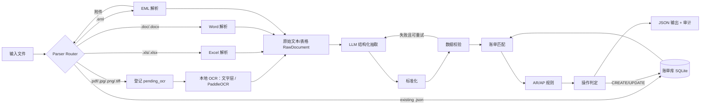
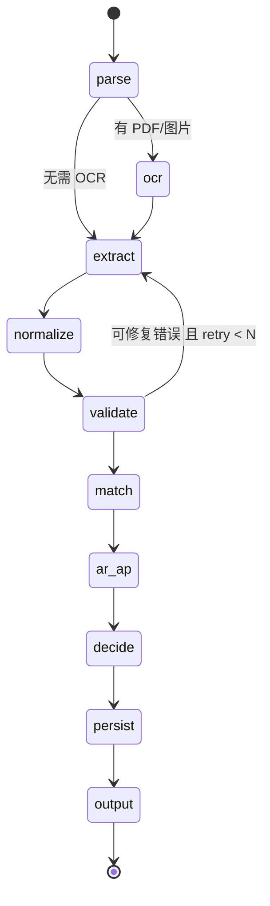

# 航运智能账单助手 Agent：开发文档

> 版本：v0.2（草案）｜ 日期：2026-11-01 ｜ 依据：test.pdf（AI agent 笔试题，最新版）

---

## 1. 项目概述

航运和货代业务的费用信息散落在邮件、PDF 账单、扫描件、Excel 和 Word 中。本项目要开发一个 Agent，能自动完成以下工作：

1. 解析多种格式的输入（EML / PDF / 图片 / Excel / Word / 已有账单 JSON）；
2. PDF 和图片登记为待 OCR，由本地 OCR 补充文本和表格（PDF 文字层优先，扫描页和图片用 PaddleOCR）；
3. 抽取单据和费用明细，并对费用名称、币种、付款方式做标准化；
4. 与已有账单做匹配，判定新增、更新、无变化或待人工复核；
5. 从记账主体的视角判断 AR/AP；
6. 校验数据，识别重复、冲突和低置信度结果；
7. 按约定格式输出 JSON，并保留来源和处理依据。

**强制约束**：开发语言为 Python，框架为 LangChain。交付物为代码 zip 或 Git 仓库。

---

## 2. 需求与模块对照

| 验收标准 | 负责模块 | 章节 |
|---|---|---|
| 1. 解析 EML 正文及附件 | `parsers/eml.py` + Router 递归 | 6.1 |
| 2. 调用 OCR 识别 PDF 和图片 | `parsers/pdf_image.py`（登记）+ `ocr/`（文字层 + PaddleOCR） | 6.1、6.2 |
| 3. 解析 Excel 和 Word 中的费用表格 | `parsers/excel.py`、`parsers/word.py` | 6.1 |
| 4. 提取单据编号、费用、金额、币种 | `extract/` (LLM 结构化抽取)、`skills/`（skill + 校验 hook） | 6.3 |
| 5. 区分新增账单与更新账单 | `billing/matcher.py`、`billing/operation.py` | 6.6、6.7 |
| 6. 结合记账主体判断 AR/AP | `rules/ar_ap.py` | 6.8 |
| 7. 检测重复账单与数据冲突 | `validate/`、`billing/matcher.py` | 6.5、6.6 |
| 8. 通过 Harness 工程提升稳定性 | `graph/`、`harness/` | 7、8 |
| 9. 补充思考（5 点以上） | 本文第 12 章 | 12 |
| 10. 基于 Python 和 LangChain 实现 | 全局 | 3 |

---

## 3. 技术栈

| 类别 | 选型 | 说明 |
|---|---|---|
| 语言 | Python 3.11+ | |
| Agent 框架 | LangChain + LangGraph | 用 LangGraph 状态机编排主流程，LLM 调用走 LangChain |
| LLM | DeepSeek（`langchain-deepseek`，默认 `deepseek-v4-pro`） | 关闭思考模式，用 function calling 做结构化输出 |
| 结构化输出 | Pydantic v2 + `with_structured_output` | 强约束 LLM 输出 |
| 邮件解析 | `email` 标准库（`policy.default`） | 处理头部解码和多级 MIME |
| Excel | `openpyxl`、`pandas`、`xlrd`（.xls） | |
| Word | `python-docx`；.doc 先用 LibreOffice 转换 | |
| PDF 文字层 | `pdfplumber` | 系统生成的 PDF 直接读文字层，不走 OCR |
| OCR | PaddleOCR 3.x（PP-StructureV3：版面 + PP-OCRv5 + 表格结构） | 本地运行；可选依赖 `.[ocr]` |
| 本地数据库 | SQLite（`sqlite3` 或 SQLModel） | 轻量，支持索引和事务 |
| 模糊匹配 | 标准库 `difflib` | 用于公司名（记账主体别名）匹配，只用来发现“很像但不相同”的名字并转人工 |
| 测试 | `pytest` | |
| 配置 | `pydantic-settings` + `.env` / YAML | |

---

## 4. 总体架构



**设计原则：LLM 只负责理解非结构化文本（结构化抽取）。** 匹配、AR/AP、操作判定、校验全部用确定性代码实现。这样结果可测试、可复现、可解释。

---

## 5. 目录结构

```
shipping-bill-agent/
├── README.md
├── development.md
├── pyproject.toml
├── .env.example
├── config/
│   ├── settings.yaml          # 记账主体、阈值、OCR、LLM 配置
│   ├── charge_mapping.yaml    # 费用名称标准化表 ✅
│   ├── currency_alias.yaml    # 币种别名 → ISO 4217 ✅
│   └── entity_alias.yaml      # 记账主体别名 ✅
├── src/bill_agent/
│   ├── main.py                # CLI 入口
│   ├── models/                # Pydantic 数据模型
│   │   ├── raw.py             # RawDocument
│   │   ├── extraction.py      # ExtractedDocument / ExtractedCharge
│   │   ├── record.py          # ChargeRecord / BillRecord（数据库记录） ✅
│   │   └── output.py          # 标准输出格式
│   ├── parsers/
│   │   ├── detect.py          # 文件头识别类型
│   │   ├── router.py
│   │   ├── eml.py
│   │   ├── html_text.py       # HTML 正文 → 文本 + 表格
│   │   ├── excel.py
│   │   ├── word.py
│   │   ├── convert.py         # LibreOffice 转换 .doc/.xls
│   │   ├── table_utils.py     # 表头定位
│   │   ├── blob_store.py      # 原文件存档
│   │   ├── json_bill.py
│   │   └── pdf_image.py       # 登记为 pending_ocr
│   ├── ocr/
│   │   ├── interface.py       # OCRBackend 接口、run_ocr
│   │   ├── pdf_text.py        # PDF 文字层读取 / 页面渲染
│   │   ├── paddle.py          # PaddleOCR PP-StructureV3 封装
│   │   └── local.py           # LocalOCR：按页组合文字层与 OCR
│   ├── extract/
│   │   ├── prompts.py
│   │   ├── extractor.py       # 抽取 + 代码核验 + 带反馈重试
│   │   ├── numbers.py         # 数字查找与算术一致性
│   │   ├── reviewer.py        # LLM 语义审核
│   │   ├── gate.py            # 把关流程与重试上限
│   │   ├── compare.py         # golden 对比
│   │   └── review_eval.py     # 审核模型评测
│   ├── normalize/
│   │   ├── charge.py
│   │   ├── currency.py
│   │   └── payment_term.py
│   ├── validate/
│   │   ├── rules.py
│   │   └── evidence.py        # 原文溯源校验
│   ├── billing/
│   │   ├── repository.py      # SQLite 读写 ✅
│   │   ├── bill_json.py       # 已有账单 JSON 导入映射 ✅
│   │   ├── matcher.py         # 4 级匹配 ✅
│   │   └── operation.py       # CREATE/UPDATE/NO_CHANGE/PENDING_REVIEW + diff ✅
│   ├── rules/
│   │   └── ar_ap.py           # AR/AP 判断 ✅
│   ├── graph/
│   │   ├── state.py
│   │   ├── nodes.py
│   │   └── build.py           # LangGraph 组装
│   └── harness/
│       ├── retry.py
│       ├── confidence.py
│       └── tracing.py
├── data/
│   ├── samples/               # 题目样例（百度网盘下载）
│   └── bills.db
└── tests/
    ├── unit/
    ├── golden/                # 输入 + 期望输出
    └── test_end_to_end.py
```

---

## 6. 模块设计

### 6.1 多格式解析（Parser Router）

**状态：已实现**，代码在 `src/bill_agent/parsers/`。这一层只规定各类文件怎么进来、进来之后怎么处理，统一产出 `RawDocument`（定义在 `models/raw.py`），不提取任何业务字段。

**各类输入的去向：**

| 输入 | 处理 | 产出状态 |
|---|---|---|
| EML | 解析邮件头和正文（text/plain 优先，表格从 text/html 中提取）；每个附件送回 Router 递归处理；转发邮件（message/rfc822）同样递归 | `parsed` |
| Excel（.xlsx / .xls） | 读取每个可见工作表，展开合并单元格，定位表头；表头以上的内容保留在 text 中 | `parsed` |
| Word（.docx / .doc） | 按文档顺序提取段落和表格；页眉、页脚、文本框的内容也收进来 | `parsed` |
| PDF / 图片 | **只登记，不识别**：原文件按内容哈希存档（`file_ref`），text 留空 | `pending_ocr` |
| 已有账单 JSON | 原样交给账单库模块，不生成 RawDocument | — |
| 其他（txt、zip 等） | 记入 `skipped` 并写明原因 | — |

**RawDocument 的状态：**

```
EML / Excel / Word ──解析──▶ parsed ─────────────────┐
PDF / 图片 ──登记──▶ pending_ocr ──OCR 成功──▶ ocr_done ──┼──▶ 进入 LLM 抽取
                              └─OCR 失败──▶ ocr_failed ─┘（不进入抽取，可重试）
```

状态和字段必须一致，否则模型直接报错：

- PDF 和图片不能是 `parsed`；其他类型只能是 `parsed`。
- `pending_ocr` 时必须有 `file_ref`，text 和 tables 必须为空。
- `ocr_done` 时必须记录 `ocr_engine`，text 和 tables 不能同时为空。
- `ocr_failed` 时必须记录 `ocr_error`；原文件引用保留，方便重试。
- 只有 `parsed` 和 `ocr_done` 的文档会进入抽取（`ready_for_extraction`）。

**模块职责：**

| 模块 | 职责 |
|---|---|
| `detect.py` | 以文件头（magic bytes）为主识别类型，扩展名和 MIME 只做兜底，所以附件扩展名错了也能识别（例如实际是 PDF 的 `DN.dat`）；同时给出正确的扩展名和 MIME |
| `router.py` | 分发到对应解析器；内容相同（sha256 相同）的文件只处理一次；单个文件失败只记入 `skipped`，不中断整批；嵌套层数上限 5；补齐文件名、MIME、大小；`source_path` 使用**相对于输入目录的路径**，统一用 `/` 分隔（传入单个文件时只用文件名），附件追加 `#attachments/<文件名>` |
| `eml.py` | charset 异常时逐级降级；正文中内嵌的小图片（<20KB，通常是 logo）不登记 |
| `excel.py` / `word.py` | .xls / .doc 优先用 xlrd 读取，否则用 LibreOffice 转换；合并单元格展开为重复值，保证每列和表头对齐 |
| `table_utils.py` | 定位表头：在前 30 行里，取命中关键词的**不同值**最多、且**不含数字单元格**的那一行 |
| `blob_store.py` | 按内容寻址保存原文件（`<sha256>.<真实扩展名>`） |
| `json_bill.py` | 已有账单 JSON 支持 `[...]`、`{"bills"/"records"/"data": [...]}` 和单个对象三种结构 |

邮件正文本身也可能就是一份对账单或改账说明（例如“请将 Handling Fee 改为 USD 40”），所以**正文也作为一份 RawDocument 进入抽取流程**。

**用来检查解析效果的命令：**

```bash
python -m bill_agent parse <文件或目录>... [--blob-dir data/blobs] [--out parsed.json]
```

### 6.2 OCR 服务

**状态：已实现本地 OCR**（`src/bill_agent/ocr/`）。题目指定的 OCR API 不接入。

```python
from bill_agent.ocr import LocalOCR, run_ocr
docs = run_ocr(parse_result.documents, LocalOCR(device="cpu"))   # device="gpu" 需安装 paddlepaddle-gpu
```

```bash
pip install -e ".[ocr]"
python -m bill_agent parse <文件或目录>... --ocr [--ocr-device cpu|gpu] [--out output/ocr.json]
```

**按页选择识别方式：**

| 输入 | 处理 | `ocr_engine` | 置信度 |
|---|---|---|---|
| PDF 页有可用文字层 | `pdfplumber` 读取 layout 文本（保留列对齐） | `pdf-text-layer` | 1.0 |
| PDF 页没有文字层（扫描件），或文字层字体缺少 Unicode 映射（`(cid:N)`、替换字符超过 5%） | 按 200 DPI 渲染成图片，交给 PaddleOCR | `paddleocr/PP-StructureV3` | 文本行分数平均值 |
| 图片（多页 TIFF 每帧一页） | PaddleOCR | `paddleocr/PP-StructureV3` | 同上 |

一份文档里两种方式都用到时，`ocr_engine` 记为 `pdf-text-layer+paddleocr/PP-StructureV3`，`raw_response.pages[]` 里逐页记录来源。文档置信度取各页的最小值。

**设计取舍：**

- **文字层优先**：题目测试集的 2 个 PDF 和邮件里的 MBL / HBL 都是系统生成的，带文字层。直接读取与原文完全一致，不会出现 0/O 之类的识别错误，耗时也只有毫秒级。
- **文字层不提取表格**：在 DN DC-108478 上，`pdfplumber` 的表格提取把三行费用挤进一个单元格，还丢了 DESCRIPTION 列。错误的表格比没有表格更危险，所以费用表交给 LLM 从 layout 文本中读取。
- **OCR 表格**：PP-StructureV3 输出 HTML 表格，转换为二维数组时展开 colspan / rowspan，合并单元格重复填值，表头交给 `build_table` 统一定位，与 Excel / Word 一致。
- **不丢文本行**：PP-StructureV3 的版面分析会漏掉部分文本行（ZIM 样例的 `1X40 HC` / `JXLU4504463` 不在任何版面块里）。识别到但没有进入版面块的行，补在文本末尾的 `[未归入版面块的识别文本]` 下。
- **结果缓存**：`CachedOCR` 按文件 SHA256 + 后端名缓存到 `data/ocr_cache/`，同一文件不重复识别（`--ocr-cache ''` 关闭）。
- **低置信度留痕**：分数低于 0.8 的文本行写入 `warnings`；每一行的文字、分数和坐标保存在 `raw_response`，供校验环节核对具体字段。
- **模型懒加载**：只有遇到扫描页或图片才加载 Paddle。首次运行时会下载模型到 `~/.paddlex`。
- **已知问题**：Paddle 3.3 的 CPU 版开启 oneDNN 时，版面模型会报 `ConvertPirAttribute2RuntimeAttribute` 错误，因此固定 `enable_mkldnn=False`。CPU 上每张图片约 1 分钟，可以改用 GPU 加速。

**样例上的识别结果：**

- ZIM 发票 PNG：费用表完整识别（两行费用 + 合计 26.90），平均置信度 0.96。Base 列第二行原图左侧被裁切，只显示 `ᴾTT`，OCR 结果为 `TT`。
- 邮件正文的 `InsertPic_C25B.jpg` 是邮件签名里的宣传横幅（"中美跨境·数智工具"），不含费用信息。

**接口**（`ocr/interface.py`）：其他 OCR 实现（视觉模型、题目原 API）也可以按同一接口接入。

```python
class OCRBackend(Protocol):
    name: str                                                    # 默认记入 RawDocument.ocr_engine
    def recognize(self, doc: RawDocument, data: bytes) -> OCRResult: ...

@dataclass
class OCRResult:
    text: str
    tables: list[list[list[str | None]] | RawTable] = []         # 二维表格即可，表头由统一逻辑定位
    confidence: float | None = None                              # 0~1
    raw_response: dict | None = None                             # 原始输出，用于审计
    warnings: list[str] = []
    engine: str | None = None                                    # 实际使用的引擎，覆盖 backend.name
```

`run_ocr` 只处理 `pending_ocr` 和 `ocr_failed` 状态的文档，从 `file_ref` 读取原文件。识别成功调用 `complete_ocr()` 转为 `ocr_done`，抛出异常则调用 `fail_ocr()` 转为 `ocr_failed`。其他文档原样返回，顺序不变。

### 6.3 信息抽取（LLM）

用 `llm.with_structured_output(ExtractedDocument)` 做抽取，temperature 设为 0。

**抽取结构只包含 test.pdf 要求的字段**（代码见 `src/bill_agent/models/extraction.py`）。单据上的其他信息，如船名、港口、结算条款、汇率、单独一列的费用代码等，一律不抽取，后续业务需要时再加。`tests/unit/test_samples.py::test_schema_only_has_spec_fields` 锁定了字段集合：新增字段必须有题目依据，并同步修改这个测试。

```python
class ExtractedCharge:                 # 每个费用项一条（四.4）
    line_no: int                       # 行序号，同名费用靠它区分（四.4、四.7 重复提取）
    charge_name_raw: str               # 费用名称（四.2）
    quantity / unit_price / amount     # 数量、单价和金额（四.2）；贷记、退款为负数
    currency_raw: str | None           # 币种（四.2）
    payment_term_raw: str | None       # PP / CC 等付款方式（四.2）
    evidence: dict[str, Evidence]

class DocumentTotal:                   # 小计、税额和总计（四.2），按币种分组
    currency_raw, subtotal, tax_amount, total_amount

class ExtractedDocument:
    source_id: str                     # 文件来源（二.9）
    document_type_raw, reference_no, document_date_raw   # 单据类型、编号及日期（四.2）
    issuer, recipient                  # 签发方和接收方（四.2）
    payee, payer                       # 单据写明的收款方 / 付款方：收费方向（四.6）
    shipper, consignee, carrier        # 寄件人、收件人、送货人，按语义判断，不依赖固定标签（用户确认的业务字段，不来自题目）
    bl_nos: list[str]                  # 提单号（四.5 规则 2）
    booking_no: str | None             # 订舱号（四.5 规则 3）
    container_nos: list[str]           # 箱号（四.5 规则 4）
    currency_raw: str | None           # 单据级币种；费用行没有币种时使用（四.2）
    charges: list[ExtractedCharge]
    totals: list[DocumentTotal]
    change_instructions: list[ChangeInstruction]   # 明确的改账要求（四.5 只改明确要求变更的字段）
    evidence: dict[str, Evidence]      # 字段名 → 原文证据（二.9、七.1 不得虚构）
```

- 需要标准化的字段（单据类型、日期、币种、付款方式、费用名）在这一层只保存原文（`*_raw`），由 normalize 模块转换。
- 金额内部用 `Decimal`；像 `4O.00` 这种字母混进数字的值直接报错，交给校验环节（四.7）。
- `evidence` 只能指向已定义的字段，模型编造的字段名会被拒绝。

**样例上的处理说明**（人工标注的理想抽取结果在 `tests/fixtures/samples/*.expected_extraction.json`）：

| 样例现象 | 处理 |
|---|---|
| DN DC-108478 中有两行 `HANDLING CHARGE`（65.00 / 35.00） | 用 `line_no` 区分。匹配规则 1（单据号 + 费用名）不唯一，需要再用行号或金额区分 |
| DN 收件方为空，但写明 “BALANCE DUE TO NEPTUNE…”；ZIM 写明 “payments must be issued to…”；CMA 写明 “REMIT TO CMA CGM” | 填入 `payee`，作为 AR/AP 的主要方向证据（见 6.8） |
| DN 同时有 Master B/L 和 House B/L | 两个都放进 `bl_nos`，匹配时都参与 |
| DN 费用行没有币种，只有表头 CURRENCY USD | 填单据级 `currency_raw`，费用行缺币种时继承 |
| ZIM 发票日期 10/03/2025 | 日期只存原文，标准化时再判断 MM/DD 或 DD/MM |
| ZIM 没有 PP/CC | `payment_term_raw` 保持 null，不做推测 |
| 样例中有银行账号、路由号 | schema 中没有对应字段，不抽取 |
| CMA CGM General Notice（PDF示例账单1）**没有单据编号** | `reference_no` 为 null；匹配规则 1 不可用，靠提单号走规则 2 |
| B/L 在同一页写作 `CMDUCHN4053601` 和 `CMDU CHN4053601` | 匹配前去掉提单号中的空格 |
| Pre-alert 邮件**正文里有一笔费用**：`SHA pay TAR：H/C $50`，同时写明 `Carrier Free H/C` | 邮件正文也要抽取费用。`H/C` 不在题目给的标准化表中，原样保留；`SHA` / `TAR` 原样抽取为付款方和收款方 |
| 同一封邮件写明 `FREIGHT PREPAID` | 只适用于运费，不能套用到 H/C 这笔费用上 |
| 邮件正文嵌入的 `InsertPic_C25B.jpg` | OCR 后确认是邮件签名里的宣传横幅，不含费用 |

**实现**（`src/bill_agent/extract/`，状态：✅ 已实现）：

```bash
python -m bill_agent extract <文件或目录>... [--out output/extracted.json] [--max-retries 3]
python -m bill_agent extract-eval --samples-dir "D:/Leetcode/demo/笔试题AIAGENT" [--out output/extract_eval.json]
```

1. **分组**：一个上传文件及其所有附件为一组，一次 LLM 调用。邮件正文和附件一起交给模型，因为正文可能补充附件的信息，或者本身就是一笔收费。
2. **模型输出结构**（`LLMExtraction`）专为模型设计，与 `ExtractedDocument` 分开：
   - 金额让模型照抄原文字符串（如 `"1,310.40"`），由 `parse_amount` 解析。`4O.00` 这类 OCR 混淆会在解析时报错。
   - 证据用 `[{field, quote}]` 列表，避开开放字典。
   - `source_id` 不让模型填写：模型只给出 `source_doc`（"文档 N"），由代码映射；证据的来源文件由代码在原文中查找确定。
3. **核验**（`convert`）：
   - 通过 `ExtractedDocument` 的模型校验：金额可解析、证据字段名存在、行号唯一。
   - 所有照抄字段（单据信息、交易双方、匹配键、币种、付款方式、费用名、证据摘录）都必须能在原文中找到（忽略空白和大小写）。
     单据级字段的值和"摘录是否包含值"的比对还忽略标点：公司名 `CO.LLC` 与 `Co., LLC` 视为相同。
   - 数字按完整数值比较（忽略千分位），`50` 不会误命中 `150`。
   - 数量 × 单价、费用行加总、小计 + 税额必须与单据上的数字一致（比较绝对值，容差 0.01，按币种分组）。
   - 签发方和接收方不能相同。
   - 付款方式必须是已知写法（PP、CC、Prepaid、Collect 等）。单字母 `C`、`P` 只在有明确反证时不采信：单据有 Base / Basis 列，又没有付款方式列。不要求原文有固定列名，CMA 的 `C` 在 `AMOUNT TYPE` 列下，不受影响。
   - **没有相关语义就留空（已确认，适用于任何输入文件）：** 由模型按语义判断，没有相关语义时填 null。单据级字段（`EVIDENCE_REQUIRED`）有值却没有证据摘录时，先退回让模型补摘录；重试用完仍没有才置为 null，并记入 `cleared`。值跨行时，摘录是值的一部分也算有依据。提单号、箱号和费用行不走这一条，它们逐项回原文查找。
   - 不能一缺证据就清空：实测模型常常只是漏写摘录，或只引用 `REMIT TO` 这个标签，直接清空会丢掉 CMA 的签发方、收款方和 DN 的单据类型，审核也拦不住。
   - **摘录不合格时由代码回原文找证据**（`anchored_evidence`）：多栏排版中标签和值分在上下两行，模型常把两行拼成一句（`BOOKING NUMBER 4055331281`），或只引用标签行。代码在原文中找到包含值的行，摘录里的标签出现在这一行或上面 3 行内时，用原文从标签行到值所在行的连续片段作为证据。找不到标签时仍退回模型，防止把不相干的数字当成字段值。
   - **复用同一张单据里的证据**：摘录不含完整值（如 CMA carrier 只引用了 `...payable to CMA CGM`），而同一张单据里别的字段的证据已经包含这个值时（issuer 的证据含 `CMA CGM (AMERICA) LLC`），直接复用。
   - **漏抽检查**（`OMISSION_LABELS`）：原文有 `BOOKING NUMBER` 这类标签、`booking_no` 却为空时，作为问题退回模型核实。只在整份抽取的轮次检查，模型核实后仍填 null 就接受。DN、CMA 原文没有这个标签，不会误报。
   - 同一号码的不同写法（`CMDUCHN4053601` / `CMDU CHN4053601`）去重。
4. **带反馈重试，只补问题字段**：第一次把全部原文交给模型，整份抽取。之后最多重试 3 次（`max_retries`），按问题类型（`Problem.kind`）决定怎么重试：

   | 问题类型 | 例子 | 下一轮 |
   |---|---|---|
   | `field`：单据级字段的值或证据 | 证据摘录不含值、值在原文中找不到、订舱号漏抽、totals 的证据找不到 | 只把这些问题发给模型，模型按 `LLMPatch.fields` 给出字段的新值和摘录 |
   | `price`：价格 | 费用行加总与合计不一致、数量 × 单价 ≠ 金额、金额在原文中找不到或无法解析 | 只让模型对照原文复核这张单据的数量、单价、金额和合计（`LLMPatch.prices`），不增删费用行、不改费用名 |
   | `other`：结构性问题 | 单据序号越界、费用名找不到、付款方式不合格、签发方等于接收方、模型没有按结构输出 | 把错误和上一次的输出发回，整份重新抽取 |

   一轮的问题全部是 `field` / `price` 时才只补问题；模型给出的修正由 `apply_patch` 合并进上一次的完整输出，其他字段不变，再整体重新核验。每次尝试的问题记在 `attempt_errors`，方式（`full` / `patch`）记在 `attempt_modes`，修正内容记在 `patches`。重试后仍未解决的记在 `errors`，由 6.3.1 的把关流程转为待人工复核。
5. **golden 对比**（`extract/compare.py`）：文本字段忽略空白和大小写，公司名字段再忽略标点，提单号、箱号按集合比较，费用行按 `line_no` 对齐，合计按币种对齐，金额按数值比较。`tests/fixtures/samples/manifest.json` 记录 golden 与原件的对应关系。

**Prompt**（`extract/prompts.py`）分两部分：

- **输入格式说明**：文档分隔标记、layout 文本的列对齐、OCR 表格的 ` | `、分页标记、未归入版面块的文本、低置信度提示。
- **抽取规则**：
  - 只抽取本单实际收费的费用行，条款里的费率和免收费用不算。
  - 邮件正文里写明金额的收费也要输出。
  - 所有值逐字照抄原文，不翻译、不换算、不补全；没有的填 null。
  - 费用名称栏照抄完整内容，包括其中的费用代码；公司名不带末尾的站点简称。
  - 付款方式只取明确标注的列；单据级币种取单据头部或合计行写明的币种，只有费用行写了币种时不推断。
  - payee / payer 只在原文明确写出时填写。
  - 证据必须是同一行内的连续文字。

**样例实测**（DeepSeek `deepseek-v4-pro`，`max_retries=3`，2026-11-08）：

- `extract-eval` 跑两次，3 份 golden 共 90 个字段，两次都是 **90 / 90**。
- 完整流程（抽取 + 审核）4 份样例各跑一次，全部通过；ZIM 修正 totals 证据的问题后又跑了 2 次，都通过。

| 样例 | 抽取模型调用 | 重试内容 |
|---|---|---|
| CMA | 1 次 | 无，issuer、carrier 都保留 |
| DN | 2 次 | 只补 `document_type_raw` 的证据 |
| ZIM | 2 次 | 补日期和 totals 的证据，并复核数量列被填成 `C` / `TT` 的价格 |
| 邮件 | 2 次 | 漏抽检查发现订舱号为空，补回 `4055331281` |

改动前（同日上午）是 87 / 90：CMA 的 issuer、recipient、carrier 因摘录只引用了标签行被清空；邮件订舱号因摘录拼接了上下两行被清空。重试改为只补问题字段前，CMA 最多要抽 6 次，邮件每次用满 3 次。

**名称写法（已确认）：**

- 费用名称栏逐字照抄，不移除费用代码，CMA 的费用名是 `OCA17 On Carriage Additional - US Em`。
- 公司名不带末尾的站点简称，DN 的 `NEPTUNE SHIPPING LIMITED (LAX)` 填 `NEPTUNE SHIPPING LIMITED`；名称中间的括号保留，如 `CMA CGM (AMERICA) LLC`。
- 公司名不带代理说明，ZIM 的 `... Co., LLC As Agents for Zim Integrated Shipping Services Ltd.` 填 `... Co., LLC`。
- 单据级币种取单据头部或合计行写明的币种：DN 的 `CURRENCY USD`、CMA 的 `TOTAL CHARGES TO BE PAID: USD`、ZIM 合计行的 `USD`。

### 6.3.1 抽取质量把关

**状态：已实现**，代码在 `extract/gate.py`、`extract/reviewer.py`、`extract/numbers.py`。抽取结果通过把关后才能进入标准化。

```bash
python -m bill_agent extract <文件或目录>... [--max-retries 3] [--max-review-retries 1] [--no-review] [--out ...]
python -m bill_agent review-eval --samples-dir "D:/Leetcode/demo/笔试题AIAGENT" [--out output/review_eval.json]
```

**分工：精确比对和算术用代码，语义判断用 LLM。** 代码不从原文里提取字段，而是拿抽取出的值回到原文查找，所以原文是整段文本也能核验。这一层防编造和算错，但查不出“值在原文里、却填错了字段”，这部分交给审核模型。

| 步骤 | 执行者 | 失败时 |
|---|---|---|
| 值能否在原文中找到 | 代码（`convert`） | 只补问题字段或整份重抽（见 6.3 第 4 步），最多 `max_retries` 次，仍失败转待人工 |
| 证据不足被清空的字段 | 代码（`convert` 记入 `cleared`） | 审核通过后仍转待人工，理由写明字段和原值 |
| 数字一致性、签发方不等于接收方 | 代码（`check_numbers`、`convert`） | 同上 |
| 语义检查 | LLM（`Reviewer`） | 带审核意见重抽，最多 `max_review_retries` 次，仍有问题转待人工 |
| 数据校验（6.5） | 代码（`validate.Validator`），作为 agent hook 在 skill 返回后运行（见 6.3.2） | error 带校验问题只补问题字段，最多 3 次，仍有转待人工；warning 只记入 `GateResult.warnings` |

**审核模型：**

- 输入原文和抽取结果，输出对每个字段的判断。值为 null 的字段也要审核，用来发现漏填；漏抽的费用行单独列在 `omissions`。
- 只给判断，不改结果，保证每个数据都只来自抽取环节并有原文依据。
- 判为有问题时必须附原文摘录，代码核验找不到的意见记入 `dismissed`，不算问题，但保留在输出里。
- 没有覆盖全部字段时带着缺失列表再审一次，仍不完整就转待人工，不当作通过。
- 与抽取使用同一份规则（`EXTRACTION_RULES`），另加审核专用要求。规则相同也意味着盲区相同：页面抬头印的是收件方时，审核模型和抽取模型会一起判错，这类情况靠代码的“签发方不等于接收方”拦下。
- issuer / recipient 按语义判断：规则说明 SHIPPER、CONSIGNEE、NOTIFY 是货物各方，只作为判断依据，不直接等同账单双方。DN 的 CONSIGNEE 是 AEBO，与账单双方无关。

**重试上限：** `ReviewGate.run_group` 返回 `passed` 或 `needs_review`，后者附 `reasons` 和每一轮的记录。有字段因为证据不足被清空（`cleared`）时，即使审核通过也转待人工：被清空的可能是正确的值。skill 内一次调用最多：抽取 `(max_retries + 1) × (max_review_retries + 1)` 次，默认 8 次（只补问题的轮次输出很短）；审核 `(max_review_retries + 1) × 2` 次，默认 4 次。数据校验 hook 每退回一次，就再调用一次 skill（只处理有问题的组），默认最多 3 次。代码核验没通过时不调用审核模型。待人工只是一个状态，暂停、等待确认、继续处理的流程在 LangGraph 阶段实现，届时按状态连接条件分支。

**评测（`review-eval`）：** golden 不应被误报；故意改坏的字段应被发现。改坏方式只动语义、不破坏算术（漏抽一行除外），例如签发方填成对方、单据号与提单号互换、数量与单价互换、收款方漏填，代码核验查不出来。

**实测**（DeepSeek `deepseek-v4-pro`，2026-11-07）：

| 样例 | golden 误报 | 改坏字段发现 |
|---|---|---|
| DN DC-108478 | 0 | 5 / 5 |
| ZIM ORFR1618731 | 0 | 4 / 4 |
| CMA Notice | 0 | 3 / 4 |

完整流程 4 份样例各跑 3 次，共 12 次全部通过；golden 对比 85/90。付款方式、寄件人、收件人全部正确，DN、CMA 的交易方全部正确。

**issuer 口径（已确认）：** 实际收取本单费用的航运公司，Credit Note 则是退款的一方，不看页面顶部印着谁。

**货物三方：** 按语义判断，不依赖固定标签。邮件的寄件人和收件人取自 HBL。ZIM 的 `From` / `To` 是港口，发票上没有货主，两者为 null（已确认）。

**送货人（已确认）：** carrier 只取决于谁收取本单费用：收取本单费用的航运公司就是 carrier，不看船名、船属于哪家公司或提单号前缀。ZIM 的 carrier 是 ZIM American（收费方）。提单上的 SHIPPER、FORWARDING AGENT 不是送货人。邮件的 carrier 为 null。

**已知问题：**

- 值跨多行时（如很长的公司名分两行），`anchored_evidence` 找不到证据（暂缓）。
- `anchored_evidence` 只看值上面 3 行，不检查标签和值是否在同一列，多栏排版中可能把旁边一栏的标签当成证据；字段含义对不对靠审核把关（暂缓）。
- 漏抽检查目前只覆盖订舱号。
- CMA 只有一行费用时，漏抽这一行查不出来；有总计但没有费用行时，代码还不报错。
- API 报错（如余额不足）会中断整批，已完成的结果不会保存（暂缓）。

**已解决（2026-11-08）：** 公司名标点差异导致的清空（`CO.LLC` / `Co., LLC`）；被清空的字段不转人工；重抽次数过多。

### 6.3.2 结构化抽取 skill 与数据校验 hook

**状态：已实现**，代码在 `src/bill_agent/skills/`。结构化抽取以后会作为 agent 的 skill 使用，数据校验因此做成 agent 的 hook：只要 agent 调用了这个 skill，校验就在它返回时发生，不依赖调用方记得去校验。

```python
skill = build_extraction_skill(ReviewGate(extractor, reviewer), load)   # load: 路径 -> 解析 + OCR 结果
agent = create_agent(model, tools=[skill], middleware=[ValidationHook(max_retries=3)])
```

| 组件 | 实现 | 说明 |
|---|---|---|
| skill `structured_extraction` | `skills/extraction.py`，LangChain `StructuredTool` | 内部是 ReviewGate（抽取 + 代码核验 + LLM 审核）。模型只看到 `paths` 一个参数。返回 `content_and_artifact`：content 是给 agent 的 JSON，artifact 是 `list[GateResult]` |
| hook `ValidationHook` | `skills/validation_hook.py`，`AgentMiddleware.wrap_tool_call` | 按工具名识别 skill 调用，其他工具直接放行。skill 返回后校验每组 `passed` 的结果 |
| `run_skill` | `skills/runner.py` | 不经过 agent 模型，按 agent 的方式执行一次 skill（依次经过 middleware）。CLI `extract` 用它，和 agent 走同一套 hook |

**流程：**

1. skill 抽取，返回结果。
2. hook 校验每组 `passed` 的结果。没有 error 就通过，warning 写进 `GateResult.warnings`。
3. 有 error 时，把问题和上一次的完整输出交回 skill，只重抽有问题的组。问题按类型决定怎么重抽（`REPAIR_KIND`）：
   - V1 箱号、V4 匹配键、V5 跨单据冲突是 `field`，只让模型补这些单据级字段；
   - V3 缺金额是 `price`，只复核价格；
   - V2 没有费用行是 `other`，带着问题整份重抽。
4. 重抽结果重新走代码核验和审核，再由 hook 校验。最多重试 3 次（`max_retries`，CLI `--max-validation-retries`），仍有 error 的组转 `needs_review`。
5. skill 自己判为 `needs_review` 的组不校验，原样返回。每一轮的记录（抽取、审核、校验）都保留在 `GateResult.rounds`。

**重抽要求怎么传给 skill：** 不放在工具参数里。agent 的 ToolNode 不让模型调用携带隐藏参数，模型也不该看到它。hook 在重试前用 `repairing(repair)` 把重抽要求放进 contextvar，skill 执行时读取。

**限制：** 目前只实现了同步的 `wrap_tool_call`，agent 用异步方式（`ainvoke`）调用时还没有 hook。

### 6.4 标准化

**状态：已实现**，代码在 `src/bill_agent/normalize/`，标准化表在 `config/`。纯代码，不调用 LLM。

```bash
python -m bill_agent normalize <extract --out 的输出 | golden 文件 | 目录>... [--out output/records.json]
```

**位置：** 结构化抽取 skill 返回、数据校验 hook 通过之后，把 `ExtractedDocument` 展开为 `ChargeRecord`（每个费用行一条，单据级字段复制到每一行），再进入匹配和 AR/AP。不在抽取层做：抽取值必须照抄原文才能回原文核验；也不在输出层做：匹配、去重要用标准名。

```python
records = Normalizer().normalize_result(gate_result)
records = Normalizer().normalize_document(doc)
```

| 字段 | 方法 | 处理不了时 |
|---|---|---|
| 费用名称（`charge.py`） | **只改写标准化表中列出的名称**：标点换成空格、合并空格、转小写后，与表中的原始名称和标准名称精确匹配，命中输出标准名称。DN 的 `HANDLING CHARGE` 输出 `Handling Charge` | 原样照抄（`4 ADD'L DETENTION FREE TIME CHARGE`、`WHARFAGE`、`H/C`、带费用代码的 `OCA17 ...`），不做模糊匹配，不交给 LLM，不转人工 |
| 币种（`currency.py`） | 行级优先，没有再用单据级；查 `config/currency_alias.yaml`（`US$`/`USD$` → USD，`RMB`/`¥` → CNY），再用 ISO 4217 白名单校验 | null，转人工。单独的 `$` 默认为美元（已确认），邮件的 `$50` 输出 USD，原文 `$` 保留在 `currency_raw`；港币、新加坡元要写成 `HK$`、`S$` |
| 付款方式（`payment.py`） | `P`/`PP`/`Prepaid`/`Freight Prepaid`/`预付`/`寄付` → PP；`C`/`CC`/`Collect`/`到付` → CC（单字母已确认）。与抽取核验 `payment_term_problem` 共用同一张表。只看费用行本身，邮件的 `FREIGHT PREPAID` 不套用到 H/C | null，不转人工 |
| 单据类型（`doc_type.py`） | 按关键词依次判断：credit → Credit Note；invoice → Invoice（ZIM 的 `DEBIT INVOICE`）；debit → Debit Note；其余 Other（CMA 的 `GENERAL NOTICE`） | 原文为空时 null |
| 日期（`dates.py`） | 去掉时间部分。月份是英文时无歧义。数字日期只有两种默认格式，按 4 位年份的位置区分（已确认）：**年在前按年/月/日，年在后按月/日/年**（DN 的 `10-24-2026`、CMA 的 `10/19/2026`、ZIM 的 `10/03/2025` → 2025-10-03）。例外：年在后、第一段大于 12（如 `24/10/2026`）时按月/日读不成日期，只能是日/月 | 年份不是 4 位（如 `10/03/25`）或不是有效日期：null，转人工 |

**原始值和标准值都保存**：`ChargeRecord` 有 `original_charge_item`、`document_type_raw`、`document_date_raw`、`currency_raw`、`payment_term_raw`。原文写法不同但标准值相同（`10/03/2025` 与 `2025-10-03`）不算 UPDATE 变更，`business_fields` 不含这些原文字段。

**转人工的原因** 写进 `ChargeRecord.review_reasons`，最终输出到 `audit_trail.review_reasons`。把关判为待人工的组也照常标准化，把关的原因带到每条记录。`ChargeRecord` 同时带上 `shipper` / `consignee` / `carrier`，M4 按付款方式推付款方时使用。

标准化表（题目给定，`config/charge_mapping.yaml`，后续可扩展）：

| 原始名称 | 标准名称 |
|---|---|
| Handling Fee, H/D Fee | Handling Charge |
| Doc Fee | Documentation Fee |
| THC | Terminal Handling Charge |
| Trucking Fee | Trucking Charge |
| Customs Fee | Customs Clearance Fee |
| Storage Fee | Storage Charge |

**样例结果**（3 份 golden + `output/extract_reviewed.json` 的 4 组，共 13 条记录）：DN 两行 `HANDLING CHARGE` → `Handling Charge`，币种继承单据级 USD，`C` → CC；CMA 为 Other / 2026-10-19 / CC；邮件 `H/C $50` 为 USD；需要人工确认的只有 CMA 一组把关原有的原因（ZIM 日期按年份位置默认月/日/年后不再转人工）。

### 6.5 数据校验

| 校验项 | 实现方式 | 失败后果 |
|---|---|---|
| 金额是否为有效数字 | 类型检查，并检查是否为 NaN 或无穷大 | 回到抽取环节重试，仍失败则标 PENDING_REVIEW |
| 币种是否符合 ISO 4217 | 白名单 | PENDING_REVIEW |
| 明细与合计是否一致 | 按币种分组，Σamount 与 subtotal 比较，subtotal + tax 与 total 比较，容差 0.01 | 降低置信度；差异超过阈值则标 PENDING_REVIEW |
| 数量 × 单价是否等于金额 | 容差 0.01 | 降低置信度 |
| OCR 混淆字符（0/O、1/l/I、5/S、8/B） | 对数字字段和单据号、箱号做模式检查。箱号遵循 ISO 6346（4 个字母 + 7 位数字，含校验位），可以直接计算校验位 | 先尝试自动纠正；有歧义则标 PENDING_REVIEW |
| 同一费用被重复提取 | 同一批次内按（单据号、标准费用名、金额、币种、箱号）去重，例如邮件正文和附件里重复出现的同一笔费用 | 合并，并在审计中记录 |
| 证据溯源 | `evidence.quote` 必须能在 RawDocument 原文中模糊匹配到 | 匹配不到的字段置为 null，并降低置信度 |
| 日期 | 能解析，且在合理范围内 | null |

**抽取结果校验：已实现**（`src/bill_agent/validate/rules.py`，纯代码，不调用 LLM）。作为 agent hook 在结构化抽取 skill 返回后运行（见 6.3.2），覆盖上表中 gate 没有管到的部分；币种 ISO 4217 和日期放到标准化之后校验（已确认）。

| 编号 | 检查 | 级别 |
|---|---|---|
| V1 | 箱号符合 ISO 6346（格式 + 校验位）；OCR 混淆字符（O/0、I/1、S/5、B/8 等）替换后能通过校验位时，给出建议值，但不自动改写（抽取值必须照抄原文） | error |
| V2 | 单据没有费用行（有合计却没有费用行时提示漏抽） | error |
| V3 | 费用行没有金额 | error |
| V4 | 单据号、提单号、订舱号、箱号全部为空，无法匹配也无法识别重复 | error |
| V5 | 同组内同一单据号的多份单据，签发方 / 日期 / 币种不一致 | error |
| V6 | 同一单据内费用名 + 金额 + 币种都相同的行 | warning |
| V7 | 同组不同单据间费用名 + 金额 + 币种都相同（邮件正文和附件重复写同一笔） | warning |
| V8 | 金额为 0 | warning |

error 带校验问题退回 skill，最多 3 次（反馈里要求原文本身如此就照抄，不要自行纠正），重抽结果重新走代码核验和审核；仍有 error 转待人工。warning 不阻止入账，合并去重留给后续批次处理。

```bash
python -m bill_agent validate <extract --out 的输出 | golden 文件 | 目录>... [--out output/validate.json]
```

实测：3 份 golden 和 `output/extract_reviewed.json` 中 4 组真实抽取结果，零 issue。

题目要求“OCR 结果不能未经校验直接入账”。因此，**没有通过校验的记录只会输出为 PENDING_REVIEW，不会写入账单库。**

### 6.6 账单库与匹配

**账单库状态：已实现**，代码在 `src/bill_agent/billing/`（`repository.py` 读写，`bill_json.py` 导入映射），CLI `db-import`。匹配（`matcher.py`）与操作判定（`operation.py`）**已实现**，CLI `apply`。

**记录粒度为费用行**，一张单据有 N 个费用就对应 N 条记录，一行即一个 `BillRecord`（`models/record.py`，即 `ChargeRecord` + `record_id` / `version` / `updated_at`）。用标准库 `sqlite3`，不用 ORM；Pydantic 模型就是结构定义。

| 设计点 | 做法 |
|---|---|
| 主表列 | 与 `BillRecord` 的标量字段一一对应（含 payee/payer、shipper/consignee/carrier、各 `*_raw`、`line_no`），测试保证列与模型字段一致 |
| 提单号、箱号是列表 | 拆到子表 `bill_bl`、`bill_container`，在子表上建索引，匹配规则 2、4 才能走索引 |
| 金额 | 存规范化后的十进制文本（`65.00`、`65` 都存成 `65`），不用 REAL，避免浮点误差，且能直接按值查 |
| 日期 | ISO 文本 `YYYY-MM-DD` |
| 费用名 | 另存一列 `charge_key`（转小写、标点换空格、合并空格），匹配规则 1–3 和改账指令都按它比较：表外费用名照抄原文，`DETENTION CHARGE` 与 `Detention Charge` 是同一个费用。只忽略写法差异，**不做同义词替换**：同义只认标准化表里 test.pdf 明确要求的（已确认）；结构版本 2 起有这一列，旧库打开时自动迁移补齐 |
| evidence / review_reasons / posting_reasoning / source_ids | JSON 文本，只用于溯源，不参与查询 |
| 结构版本 | `PRAGMA user_version`，启动时按版本逐级迁移 |
| 事务 | `transaction()` 一个批次一个事务，可嵌套，只有最外层提交或回滚 |
| 更新 | `update(record_id, changes, expected_version, source_id)`：只写 `changes` 里的字段，值经模型校验；新旧值相同不写库；否则旧记录快照写 `bill_history`，version + 1；版本对不上抛 `VersionConflict`（乐观锁） |

```sql
CREATE TABLE bill_records (record_id TEXT PRIMARY KEY, ...BillRecord 标量字段..., 
                           version INTEGER NOT NULL DEFAULT 1, updated_at TEXT NOT NULL);
CREATE TABLE bill_bl        (record_id TEXT REFERENCES bill_records ON DELETE CASCADE, bl_no TEXT,
                             PRIMARY KEY (record_id, bl_no));
CREATE TABLE bill_container (record_id TEXT REFERENCES bill_records ON DELETE CASCADE, container_no TEXT,
                             PRIMARY KEY (record_id, container_no));
CREATE TABLE bill_history   (record_id TEXT, version INTEGER, snapshot TEXT, changed_fields TEXT,
                             changed_at TEXT, source_id TEXT, PRIMARY KEY (record_id, version));
CREATE INDEX idx_ref_charge ON bill_records(reference_no, charge_key);
CREATE INDEX idx_booking    ON bill_records(booking_no, charge_key, currency);
CREATE INDEX idx_bl         ON bill_bl(bl_no);
CREATE INDEX idx_container  ON bill_container(container_no);
```

`repository` 只按匹配键查候选（`find_by_ref_charge` / `find_by_bl` / `find_by_booking` / `find_by_container`，任一键为 null 返回空，即跳过该级）；优先级、冲突判断、交易双方别名归一化放在 matcher。

**账单库的来源**（已确认）：“已有账单 JSON”由我们自己产生，不是外部样例。正常流程是 `apply` 把每批抽取结果写进账单库；后续批次抽到同一笔交易时，匹配到已有记录并以 UPDATE 合并，不新建。

**导入账单 JSON**（`db-import`）：用于导入我们导出的或手工补充的账单，支持两种形状：6.9 的标准输出格式（本程序的输出可再导入），以及键名等于 `BillRecord` 字段的平铺格式（另接受 `bl_no`、`container_no`、`charge_item_raw` 等别名）。不认识的键丢弃并提示；值不合法的记录记为错误、不影响其他记录。按 `record_id` upsert，没有 `record_id` 时用"文件内容哈希 + 序号"生成固定 id，同一文件重复导入结果为无变化。导入的数据目前不经过标准化（费用名、币种按原值入库）。

**匹配规则：4 级优先级，命中即停止，但会记录所有规则的命中情况。**

| 优先级 | 匹配键 |
|---|---|
| 1 | 单据号 + 费用名称 |
| 2 | 提单号 + 费用名称 + 币种 |
| 3 | 订舱号 + 费用名称 + 币种 |
| 4 | 箱号 + 交易双方 + 日期 + 金额 |

- 匹配键中有任何一个为 null，就跳过该级规则；提单号 / 箱号有多个时任一个命中即可；
- 某一级命中多条时先消歧：**同一份单据里行号不同的是该单据的另一行费用，排除**（样例 DN 两行 `HANDLING CHARGE`）；再优先行号相同、金额相同的。消歧后仍有**多条**，视为冲突，标 PENDING_REVIEW；
- 低一级规则唯一命中了**另一条费用名称相同的记录**，视为冲突。命中费用名不同的记录只记录、不算冲突：规则 4 不含费用名，同一箱、同一天、同金额的不同费用很常见；
- 同一批次里两条新费用行匹配到同一条已有记录（含本批次刚新建的），视为冲突；
- 交易双方比较前先经过公司别名表（`config/entity_alias.yaml`）归一化。
- 每条结果的 `ai_reasoning` 里列出四级规则各自的命中情况。

### 6.7 操作判定与字段级 Diff

```
无匹配 且 校验通过                      → CREATE
有唯一匹配：
    待更新字段集合为空                    → NO_CHANGE   （含重复导入）
    待更新字段集合非空                    → UPDATE
冲突 / 校验失败 / 低置信度             → PENDING_REVIEW
```

**待更新字段的计算方式（落实“只修改输入材料明确要求变更的字段”）：**
1. 如果邮件正文或单据中有明确的改账指令（`change_instructions`），只更新指令涉及的字段；
2. 否则，视为单据本身就是修订后的版本（如 Revised DN）。只有同时满足以下三个条件的字段才会更新：输入中**非 null**、有**原文证据**、而且与原值**不同**；
3. null 字段和缺少证据的字段一律保留原值；
4. 每个被修改的字段都记录“旧值 → 新值 + 证据”，写入 `ai_reasoning` 和 `changed_fields`，旧值快照写入 `bill_history`。

**实现细节**（`billing/operation.py` 的 `BillProcessor`，一个批次一个事务）：
- 提单号、箱号取**并集**，不删已有值（分批到达的单据可能各只写了一部分）；
- 原文写法字段（`*_raw`、原始费用名）跟随对应标准字段一起改，单独不同不算变更；行号只在单据号变化时跟着改；
- `accounting_entity` / `posting_type` 不直接比较，而是在合并后的记录上重新跑 AR/AP；结果不确定时转人工；
- “有原文证据”这一条默认不再检查（`require_evidence=False`）：抽取阶段已做数字代码核验和 LLM 审核，且费用行通常没有逐字段证据；需要时可打开；
- 改账指令按“单据号 + 费用名（忽略大小写和标点）”定位目标，目标不唯一、字段不支持或新值解析失败时转人工；目标不在本单据费用行里的（如邮件正文要求改另一张单据）单独输出一条 UPDATE；
- PENDING_REVIEW 不写库，CREATE / UPDATE / NO_CHANGE 之外的状态都由人工处理后再跑。

### 6.8 AR/AP 判断

**状态：已实现**，代码在 `src/bill_agent/rules/ar_ap.py`，别名表在 `config/entity_alias.yaml`。纯代码，不调用 LLM。CLI `normalize` 标准化后接着判断 AR/AP（`--entity`，默认 PAT），判断过程写进 `ChargeRecord.posting_reasoning`（不参与 UPDATE diff）。

核心原则：**LLM 只抽取签发方、接收方、单据类型和金额，AR/AP 由规则函数计算。**

**第 1 步：确定记账主体。** **记账主体是 PAT**（已确认）。主体由外部配置（`settings.yaml` 或 CLI 的 `--entity`）提供，并配一张别名表（全称、简称、英文名），不让 LLM 去猜“我方是谁”。

PAT 的别名表（**已确认**）：`PAT`、`Pilot Aiship Tech co., Ltd.`、`湃乐多（上海）航运科技有限公司`。邮件中的 `SHA` **不是** PAT，不加入别名表。

**第 2 步：确定资金方向。**

收款方和付款方分开确定（**已确认**），都是先用单据上写明的值：

**收款方（payee）：** 优先使用单据上明确写出的收款方（如 “REMIT TO”、“BALANCE DUE TO”、“payments must be issued to”）。三份样例里都有这一信息，而 CMA CGM 的 General Notice 不属于 DN/CN/Invoice，只能靠它判断方向。没有写明时，再按单据类型推断（见下表）。

**付款方（payer）：** 单据上写明了就用（如 ZIM 的 payer、邮件的 `SHA pay TAR`）。**没有写明时按付款方式判断：到付（CC）取 consignee，寄付（PP）取 shipper。** 付款方式缺失，或者对应的 shipper / consignee 为空时，才按单据类型推断（见下表）。**不用签发方去补付款方**：签发方往往只是印在抬头的公司（如 PAT、NEPTUNE 这类航运公司），不一定是账单一方。付款方式取费用行的值（抽取只在费用行上有付款方式），所以同一张单据里不同费用行的付款方可以不同。

| 单据类型 | 收款方 | 付款方（兜底） |
|---|---|---|
| Debit Note / Invoice | 签发方 | 接收方 |
| Credit Note | 接收方 | 签发方 |

兜底推出的付款方与收款方是同一家公司时，视为付款方未知。

如果金额为负，或者文本中含有 refund / rebate / 退款等语义，方向取反。

**第 3 步：确定记账类型。**

| 情况 | posting_type |
|---|---|
| 钱流入 PAT（PAT 是收款方） | `AR` |
| 钱从 PAT 流出（PAT 是付款方） | `AP` |
| PAT 不是交易任何一方 | `null`（JSON 的 null，不是字符串）。**不因此标 PENDING_REVIEW**，其他字段照常输出 |
| 无法确定是不是 PAT：去掉大小写、空白、标点后与别名不同，但相似度 ≥ 0.85（如 `Pilot Aiship Technology Co., Ltd.`），或包含完整的别名词（如 `PAT LOGISTICS LLC`） | `null` + `PENDING_REVIEW`，并在 `review_reasons` 中写明 |
| 收款方和付款方都是 PAT | `null` + `PENDING_REVIEW` |

**样例的期望结果：**

| 样例 | 收款方 ← 付款方 | 结果 |
|---|---|---|
| DN DC-108478 | Neptune（写明）← AEBO（到付，取 consignee） | `null`（PAT 不是寄件人、收件人或送货人） |
| ZIM Invoice ORFR1618731 | ZIM（写明）← USIAHALLAM（写明） | `null` |
| CMA CGM Notice（PDF示例账单1） | CMA CGM（写明）← Neptune（到付，取 consignee） | `null` |
| Pre-alert 邮件（H/C $50） | TAR ← SHA（都写明） | `null`（SHA 和 TAR 都不是 PAT） |

**第 4 步：用付款方式做交叉校验（辅助信号）。** PP 费用通常由起运港一方收取，CC 费用通常由目的港一方收取。如果主体的角色已知（Origin 或 Destination），而 PP/CC 推出的结论与第 3 步矛盾，就降低置信度并在审计中说明。这一步不推翻主判据。

**题目样例验证**：Destination Agent 向 Origin Agent 签发 Debit Note，记账主体为 Origin Agent。样例没有写明收付款方，也没有 shipper / consignee，按第 2 步的兜底，付款方是接收方 Origin Agent，所以 posting_type 为 **AP**，与题目样例一致。

```python
def decide_posting_type(doc_type, issuer, recipient, entity, amount, refund_hint,
                        stated_payee=None, stated_payer=None,
                        payment_term=None, shipper=None, consignee=None):
    by_type = {"Debit Note": (issuer, recipient), "Invoice": (issuer, recipient),
               "Credit Note": (recipient, issuer)}.get(doc_type, (None, None))
    payee = stated_payee or by_type[0]                 # 收款方：写明 > 单据类型
    payer = (stated_payer                              # 付款方：写明 > 付款方式 > 单据类型兜底
             or (consignee if payment_term == "CC" else shipper if payment_term == "PP" else None)
             or by_type[1])                            # 不用签发方补付款方
    if payer is not None and same_entity(payer, payee):
        payer = None                                   # 兜底推出的付款方就是收款方，视为未知
    if payee is None and payer is None:
        return None, "无法确定收付款方"
    if (amount is not None and amount < 0) or refund_hint:
        payee, payer = payer, payee
    if same_entity(entity, payee):  return "AR", f"{entity} 为收款方，钱流入 {entity}"
    if same_entity(entity, payer):  return "AP", f"{entity} 为付款方，钱从 {entity} 流出"
    return None, f"{entity} 不是交易任一方"          # 输出 null，不标 PENDING_REVIEW
```

### 6.9 输出格式

严格遵循题目第五节的核心结构，每个费用项输出一条记录：

```json
{
  "operation": "UPDATE",
  "document_info": {"document_type": "Debit Note", "reference_no": "DN-202609-001", "document_date": "2026-09-20"},
  "transaction_party": {"issuer": "Destination Agent", "recipient": "Origin Agent"},
  "charge_details": {"charge_item": "Handling Charge", "amount": 40.00, "currency": "USD", "payment_term": "PP"},
  "financial_attributes": {"accounting_entity": "Origin Agent", "posting_type": "AP"},
  "audit_trail": {"ai_reasoning": ["..."]}
}
```

**扩展字段**：在不改动核心字段的前提下，补充题目其他要求需要的字段。

- `charge_details.original_charge_item`：原始费用名，对应“同时保存原始和标准名称”；
- `charge_details.quantity`、`unit_price`；
- `document_info.bl_no`、`booking_no`、`container_no`；
- `audit_trail.source_file`、`source_text`（原文片段）、`matched_rule`、`matched_record_id`、`changed_fields`、`confidence`、`review_reasons`。

如果扩展字段可能影响对方的自动评测，可以加一个 `--strict-schema` 开关，开启后只输出核心字段。

输出前做最终检查：用 Pydantic 校验结构，并用 `json.dumps` 确认是合法 JSON；金额为数字类型；币种为三位代码；无法提取的字段填 `null`。

---

### 6.10 文件问答（检验解析 / OCR 结果能否支撑 LLM）

OCR 的最终用途是给 LLM 理解单据。在实现 M2 抽取之前，先用问答检验：只把解析 / OCR 后的文本交给模型，看它能否答对单据上的问题。实现在 `src/bill_agent/qa.py`，模型接入在 `src/bill_agent/llm.py`。

```bash
# 单次提问（-q 可重复）；不给 -q 进入交互模式
python -m bill_agent ask "D:/Leetcode/demo/笔试题AIAGENT/图片示例.png" -q "列出所有费用项目和金额"
# 按评测集逐题提问并判分
python -m bill_agent qa-eval tests/fixtures/qa --samples-dir "D:/Leetcode/demo/笔试题AIAGENT" --out output/qa_report.json
```

- **上下文**：每份文档的来源、识别方式、置信度、全文文本，以及低置信度行提示。未完成 OCR 的文档不进入上下文。
- **结构化输出**：`found`（文件中是否有答案）、`answer`、`evidence`（逐字摘录的原文）。
- **证据核验**：代码把每条 evidence 放回上下文中查找（忽略空白和大小写），找不到即视为编造。这与 M2 抽取的证据校验是同一套思路。
- **评测集**（`tests/fixtures/qa/*.qa.json`）：4 个样例共 35 题。`expect` 要求答案包含全部片段（比较时忽略大小写、空白和千分位逗号）；`expect_found: false` 是文件中没有答案的陷阱题，用来检验模型会不会编造。证据核验不通过的题也判为失败。

## 7. Agent 编排（LangGraph）

```python
class AgentState(TypedDict):
    inputs: list[str]
    raw_docs: list[RawDocument]
    extracted: list[ExtractedDocument]
    records: list[CandidateRecord]   # 标准化后的费用行
    errors: list[ValidationIssue]
    retry_count: int
    outputs: list[OutputRecord]
    trace: list[str]
```



| 节点 | 实现 | 是否调用 LLM |
|---|---|---|
| parse | Router | 否 |
| ocr | `run_ocr` + `LocalOCR`（只处理 pending_ocr / ocr_failed） | 否（PaddleOCR） |
| extract | 结构化抽取（把校验错误作为反馈带入下一次重试） | **是** |
| normalize | 查表（只改写标准化表中的名称） | 否 |
| validate | 规则校验 + 证据溯源 | 否 |
| match / ar_ap / decide | 确定性规则 | 否 |
| persist | 只写入 CREATE/UPDATE，单批次一个事务 | 否 |
| output | 序列化 + 最终 schema 校验 | 否 |

**为什么不用自由的 ReAct Agent**：财务数据要求结果可复现、可审计。流程固定的状态机能把 LLM 的不确定性限制在“理解文本”这一个环节里。同时，节点内部仍然可以以 LangChain Tool 的形式封装（如 `ocr_tool`、`lookup_bill_tool`），方便以后扩展成对话式 Agent，例如回答“这张单为什么被判为 AP”。

---

## 8. Harness 工程（提升稳定性与准确性）

1. **Schema 强约束**：所有 LLM 输出都用 Pydantic 定义，解析失败时自动带着错误信息重试。
2. **确定性优先**：temperature=0；匹配、AR/AP、操作判定、计算全部用代码完成。
3. **校验—反馈循环**：校验失败的具体原因（如“明细合计 120 ≠ 总计 150”）会作为反馈带入下一次抽取，最多重试 N 次（默认 2）。超过次数仍失败就标 PENDING_REVIEW，不会无限重试。
4. **证据锚定**：每个字段都必须有原文证据，并用代码核验，从机制上防止编造数据。
5. **置信度打分**：

   ```
   confidence = OCR置信度 × 证据覆盖率 × Π(校验惩罚系数)
   ```

   低于阈值（默认 0.8）的记录标 PENDING_REVIEW，并写明原因。
6. **幂等与缓存**：以文件哈希缓存 OCR 和 LLM 结果；同一文件重复处理时结果完全一致，且判定为 NO_CHANGE。
7. **事务与回滚**：每批次一个数据库事务，`bill_history` 保存版本快照。
8. **可观测性**：用 LangSmith 或本地 JSONL 记录每个节点的输入、输出、耗时和 token 用量。
9. **Golden 回归集**：用题目样例构造“输入 → 期望 JSON”，每次修改都跑 `pytest`，按字段统计准确率。

---

## 9. 配置示例

```yaml
# config/settings.yaml
accounting_entity:
  name: "PAT"
  aliases:                  # 已确认
    - "Pilot Aiship Tech co., Ltd."
    - "湃乐多（上海）航运科技有限公司"
  role: null                # origin / destination / null
parse:
  blob_dir: "data/blobs"    # PDF / 图片原文件存档
  max_depth: 5
ocr:
  engine: "local"           # PDF 文字层 + PaddleOCR PP-StructureV3
  device: "cpu"             # cpu / gpu
  dpi: 200                  # 扫描页渲染分辨率
  low_conf: 0.8             # 低于此分数的文本行写入 warnings
llm:
  provider: "openai"        # 待定
  model: "..."
  temperature: 0
thresholds:
  confidence_review: 0.8
  fuzzy_entity: 0.85        # difflib 相似度
  amount_tolerance: 0.01
  max_extract_retries: 2
```

CLI：

```bash
python -m bill_agent run \
  --inputs data/samples/ \
  --existing data/samples/existing_bills.json \
  --entity "PAT" \
  --out output/result.json
```

---

## 10. 开发计划

| 阶段 | 内容 | 产出 |
|---|---|---|
| M0 | 下载样例数据；OCR 接口约定 | `ocr/interface.py` ✅ |
| M1 | 数据模型；EML / Excel / Word 解析器；Router 递归；PDF / 图片登记为待 OCR | 解析器 + 单元测试 ✅ |
| M1.5 | 本地 OCR：PDF 文字层 + PaddleOCR PP-StructureV3 | `ocr/local.py` + 单元测试 ✅ |
| M2 | LLM 结构化抽取 + 证据；质量把关；标准化模块 | 抽取 ✅（golden 90/90 字段一致）；质量把关 ✅；标准化 ✅ |
| M3 | 校验模块；SQLite 账单库；JSON 导入 | 抽取结果校验 ✅（V1–V8）；币种 / 日期校验随标准化做；SQLite 账单库 + JSON 导入 ✅ |
| M4 | 4 级匹配；操作判定；字段级 diff；AR/AP 规则 | AR/AP ✅（样例全部为 null，与 6.8 期望一致）；匹配、操作判定、diff ✅（CLI `apply`） |
| M5 | LangGraph 编排；重试与置信度；审计输出 | 端到端可运行 |
| M6 | Golden 测试集；README；整理补充思考；打包交付 | zip 或 Git 仓库 |

---

## 11. 待确认问题

1. **OCR**：✅ 已实现本地 OCR（PDF 文字层 + PaddleOCR）。GPU 加速（paddlepaddle-gpu）待定。
2. **记账主体**：✅ 已确认为 PAT（湃乐多 / Pilot Aiship Tech），由外部配置提供；`SHA` 不是 PAT。
3. **样例数据**：已有账单 JSON 的字段结构需要对照样例确认，并据此调整 `bill_records` 的映射。
4. **LLM 选型**：✅ DeepSeek（本机已配置 `DEEPSEEK_API_KEY`），模型名可用 `--model` 或 `BILL_AGENT_MODEL` 切换。
5. **扩展字段**：输出中加入扩展字段是否会影响评测，是否需要严格只输出样例中的字段。
6. **没有已有账单 JSON**：题目测试集（2 个 PDF、1 张图片、1 封 EML）里没有已有账单 JSON。账单库从空库开始，UPDATE 只能由同一批次中先后到达的单据触发。
7. **非账单文档**：测试集中的 MBL/HBL 提单本身没有费用，但带有提单号和箱号，可以作为上下文用于匹配。Pre-alert 邮件正文里有一笔 `SHA pay TAR：H/C $50`；✅ 已确认 SHA 不是 PAT，这笔费用照常抽取，posting_type 为 null。

---

## 12. 补充思考（对应验收第 9 条）

1. **记账主体必须显式指定**：同一张 Debit Note，对签发方是 AR，对接收方是 AP。不给定视角时，AR/AP 无法确定，所以主体应该作为系统输入，而不是交给模型推断。
2. **以费用行为粒度做幂等**：同一份账单可能通过邮件正文、PDF 附件、Excel 对账单多次出现。按费用行去重，再用 NO_CHANGE 处理重复导入，避免重复入账。
3. **证据驱动，防止编造**：每个字段都要求附带原文片段并用代码核验，把“不得虚构数据”从提示词里的要求变成系统强制执行的约束。
4. **修订单与变更意图**：业务上常见 Revised DN 和邮件改账（“请将 THC 改为 USD 120”）。系统需要区分“全量修订单”和“局部改账指令”，后者只能修改指令涉及的字段。
5. **多币种与汇率**：同一张单据可能同时有 USD 和 CNY 两种币种。合计校验必须按币种分组，不能跨币种加总；如果后续要折算本位币，还需要记录汇率来源和日期。
6. **Credit Note 与原单关联**：Credit Note 往往用来冲减某张原单，应该尽量识别它引用的原单号，作为负向调整关联到原单，而不是孤立地新增一条记录。
7. **人工复核闭环**：PENDING_REVIEW 不应是终点。人工修正的结果要回流到别名表、费用标准化表和 golden 测试集中，让系统持续改进。
8. **箱号等编码自带校验**：ISO 6346 箱号有校验位，可以低成本地自动发现 OCR 错误，比单纯依靠模型更可靠。
9. **安全与合规**：账单文件上传到外部 OCR 时使用短时效签名 URL，用完即删；日志中对银行账号等敏感信息做脱敏处理。
